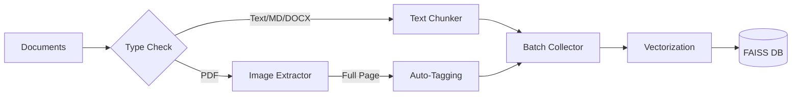

# 🤖 Simple RAG System

A **production-ready** Retrieval-Augmented Generation (RAG) system engineered for high-performance document processing.

It handles **End-to-End** flow: from raw documents (PDF, DOCX, MD) to intelligent chunking, vectorization, and accurate semantic search.


---

## ✨ Key Features

| Feature | Description |
|---------|-------------|
| **🧠 Intelligent Chunking** | Optimized recursive splitting for text (TXT, MD, PDF, DOCX) to preserve context. |
| **⚡ High-Perf Vectorization** | Uses `gte-multilingual-base` (384-dim) for SOTA multilingual embedding quality. |
| **🔍 Hybrid Search** | **Semantic Search** (Vector) + **Keyword Boosting** (Tags) for maximum accuracy. |
| **🧩 Multi-Query Search** | **RRF (Reciprocal Rank Fusion)** merges results from multiple queries for complex questions. |
| **🖼️ Smart Image Extraction** | Extracts full PDF pages or individual images, auto-tags (e.g., `Figure 4.1`, `Table 2`). |
| **🤖 Agent Integration** | Designed for **ClineSR / GaussO MM** multimodal agent with vision capability. |
| **🧪 Automated Eval** | Built-in retrieval evaluation suite (`Hit Rate`, `MRR`) with golden dataset support. |
| **📈 Self-Improving** | Feedback loop with **Tag Boosting** (3x repeat) for automatic re-embedding. |

---

## 📊 Technical Specifications

| Parameter | Value | Notes |
|-----------|-------|-------|
| **Embedding Model** | `gte-multilingual-base` | Alibaba-NLP, multilingual support |
| **Vector Dimensions** | 384 | Optimized for speed & quality |
| **Vector Database** | FAISS | IndexFlatIP (Inner Product) |
| **Chunk Size** | ~500 tokens | Configurable via settings |
| **Chunk Overlap** | 50 tokens | Preserves context boundaries |
| **Image Extraction** | PyMuPDF (fitz) | Full-page or individual mode |
| **OCR Engine** | PP-Structure (Optional) | Layout analysis & enrichment |

---

## 🚀 Quick Start

### 1. Installation

```bash
# Clone the repo
git clone <your-repo-url>
cd simple-rag

# Create virtual env
python -m venv .venv
source .venv/bin/activate  # or .venv\Scripts\activate on Windows

# Install dependencies
pip install -r requirements.txt
pip install pymupdf paddlepaddle  # Core engines
```

### 2. Prepare Data

Put your documents in the data folder:

```text
data/documents/
  ├── internal_report.pdf
  ├── api_specs.md
  └── research_paper.docx
```

### 3. Process Documents (MUST specify extraction mode)

```bash
# [RECOMMENDED] Full-Page Mode (-fp)
# Captures entire page context + images. Best for RAG with diagrams.
python -m src.main process -fp

# [ALTERNATIVE] PyMuPDF Mode (-pymu)
# Extracts individual embedded images. Precision focus.
python -m src.main process -pymu

# [ALTERNATIVE] Docling Mode (-pymu)
# Extracts individual embedded images. Precision focus.
python -m src.main process -dl
```

> ⚠️ **Note**: You MUST specify either `-fp` or `-pymu` or `-dl`. The system will error if neither is provided.

### 4. Search

```bash
# General question
python -m src.main search "what is the system architecture?"

# Specific target (High precision due to auto-tagging)
python -m src.main search "Figure 4.1"

# With top-k parameter
python -m src.main search "OAuth flow" --top-k 10
```

### 5. Advanced Search Options

```bash
# 🖼️ Image-only filter (-pic)
# Returns only image results, useful for finding diagrams/figures
python -m src.main search -pic "Connection diagram"

# 🔀 Hybrid Search (--hybrid or -hy)
# Uses BM25 + Vector for better exact-match ranking
python -m src.main search -hy "Figure 4.2: Media Payload"

# 🔗 Combine both: Find images with hybrid ranking
# 🔗 Combine both: Find images with hybrid ranking
python -m src.main search -pic -hy "Interrupt IN Flow Chart"

# 🧩 Multi-Query Search (msearch) - BEST FOR COMPLEX QUESTIONS
# Automatically runs multiple queries and fuses results (RRF algorithm)
python -m src.main msearch "bluetooth reconnection" "link loss supervision" "timeout"
```

> 💡 **Tip**: Use `msearch` when you are unsure of the exact term or when asking "How to" / "Why" questions. Break your question into synonyms.

### 6. 🧪 Quality Assurance (Evaluation)

Run the built-in evaluation suite to measure retrieval accuracy (Hit Rate / MRR):

```bash
# Run evaluation using default golden dataset
python -m src.main eval

# Options
python -m src.main eval --top-k 10 --dataset tests/data/my_golden_data.json
```

> 💡 **Tip**: Use `-hy` when searching for specific figure/table names to improve exact-match accuracy.

---

## 🏃 Workflow Example

A typical "Basic Cycle" for a new user:

```bash
# 1. Process documents (MUST choose -fp or -pymu)
python -m src.main process -fp

# 2. Search for something
python -m src.main search "system architecture"

# 3. Check tags of an image found (e.g., A2DP_v1.4.pdf_p18)
python -m src.main listtag A2DP_v1.4.pdf_p18

# 4. Add a manual tag (system automatically re-embeds!)
python -m src.main addtag A2DP_v1.4.pdf_p18 "security-diagram"

# 5. Search again with the new tag
python -m src.main search "security diagram"
```

---

## 🛠️ CLI Command Reference

| Command | Action | Example |
|---------|--------|---------|
| **`process -fp`** | Full-page image extraction | `python -m src.main process -fp` |
| **`process -fp -fmt jpeg`** | Full-page with JPEG format (smaller) | `python -m src.main process -fp -fmt jpeg` |
| **`process -pymu`** | Individual image extraction | `python -m src.main process -pymu` |
| **`search`** | Query the database | `python -m src.main search "query"` |
| **`search -pic`** | Search images only | `python -m src.main search -pic "diagram"` |
| **`search -hy`** | Hybrid search (BM25+Vector) | `python -m src.main search -hy "Figure 4.1"` |
| **`msearch`** | Multi-Query Search (RRF) | `python -m src.main msearch "q1" "q2"` |
| **`eval`** | Run accuracy evaluation | `python -m src.main eval` |
| **`list`** | Show all indexed Docs | `python -m src.main list` |
| **`listtag`** | View tags for a doc | `python -m src.main listtag doc_id` |
| **`addtag`** | Add tag & **Re-embed** | `python -m src.main addtag doc_id "new-tag"` |
| **`stats`** | View DB size/status | `python -m src.main stats` |
| **`clean`** | Reset database | `python -m src.main clean --yes` |
| **`init`** | Setup folder structure | `python -m src.main init` |
| **`addknowledge`** | Add knowledge (description) to image | `python -m src.main addknowledge doc_id "text"` |
| **`updateknowledge`** | Replace existing knowledge | `python -m src.main updateknowledge doc_id "new text"` |
| **`getknowledge`** | Get knowledge for an image | `python -m src.main getknowledge doc_id` |

---

## 🤖 ClineSR / GaussO MM Integration

This RAG system is designed to work with multimodal AI agents:

### Architecture Flow

```
User (Text + Image Query)
         ↓
    ClineSR / GaussO MM
    ├── 👁️ Vision Processing
    └── 📝 Text Processing
         ↓
    🧠 Embedding (gte-multilingual-base)
         ↓
    💾 FAISS Search
         ↓
    📑 Top-K Context (text + image paths)
         ↓
    🧠 Reasoning & Generation
         ↓
    💬 Response (Text + Images)
```

### 8-Step Data Flow

| Step | Component | Action |
| ------ | ----------- | -------- |
| **①** | Chunker & ImgExt | Extract content from documents |
| **②** | Embedding Model | Vectorize text + images (OCR) |
| **③** | FAISS | Index vectors (N+M embeddings) |
| **④** | User | Send multimodal query (text + image) |
| **⑤** | Agent → Embed | Encode query → Vector |
| **⑥** | FAISS | Similarity search → Top-K results |
| **⑦** | Agent | Generate response with vision |
| **⑧** | Feedback | Tag + Re-embed to improve search |

### Feedback Loop (Tag Boosting)

When adding a tag:

```python
# Original content
content = "Image showing authentication flow..."

# After tag boost (3x repeat for semantic weight)
boosted = content + "\nTags: oauth, oauth, oauth, auth-flow, auth-flow, auth-flow"

# Re-embed and update FAISS
new_vector = embed(boosted)  # Higher similarity to "oauth" queries
```

> 📖 **Detailed Report**: [report-doc/11-report-clineSR-withRAG.md](report-doc/11-report-clineSR-withRAG.md)

---

## 🏗️ Architecture

### Data Processing Pipeline



### Image Extraction Strategies

| Strategy | Flag | Description | Best For |
|----------|------|-------------|----------|
| **Full-Page** | `-fp` | Render entire page as image (DPI 150) | Diagrams, flowcharts, complex layouts |
| **PyMuPDF Smart Crop** | `-pymu` | Smart detection & cropping of figures | Individual images, vector drawings |
| **Docling** | `-dl` | Extract using Docling library | Alternative extraction method |

---

#### 🔵 Full-Page Mode (`-fp`) - How It Works

**File**: `src/image_extraction/extractor.py` → `_extract_fullpage_from_pdf()`

```txt
PDF Page                          ExtractedImage
┌─────────────────────┐           ┌─────────────────────┐
│  Title / Header     │           │ image_id: doc_p1    │
│  ─────────────────  │           │ region_type: fullpage│
│  [Diagram/Chart]    │  ──────►  │ surrounding_text:   │
│  Caption below      │           │   "Full page text..." │
│  Body text...       │           │   (max 10,000 chars) │
│  ─────────────────  │           │ bbox: (0,0,W,H)     │
│  Footer             │           └─────────────────────┘
└─────────────────────┘
```

**Flow**:

1. **Filter Blank Pages**: Check if page has images (`get_images()`) or drawings (`get_drawings()`)
2. **Render Full Page**: `page.get_pixmap(dpi=150)` → Save as PNG
3. **Extract Context**: `page.get_text()` → Get ALL text from page (max 10,000 chars)
4. **Auto-Tag**: Regex scan for `Figure X.Y`, `Table X.Y` patterns

**Pros**: Maximum context, great for complex layouts
**Cons**: Large file size, embedding may be "diluted" with too much text

---

#### 🟢 PyMuPDF Smart Crop (`-pymu`) - How It Works

**File**: `src/image_extraction/pymu_extractor.py` → `_extract_smart_crops()`

```txt
PDF Page                              Context Window
┌─────────────────────────────────┐
│                                 │
│  ┌───────────────────────────┐  │   
│  │  y0 -= 80px (title zone)  │  │   ← Look for title
│  ├───────────────────────────┤  │
│  │                           │  │
│  │   IMAGE BBOX (detected)   │  │   ← Smart detected region
│  │                           │  │
│  ├───────────────────────────┤  │
│  │  y1 += 150px (caption)    │  │   ← Look for caption
│  └───────────────────────────┘  │
│        ↑ x0-20px    x1+20px ↑   │   ← Horizontal padding
└─────────────────────────────────┘

       page.get_text(clip=context_rect)
              ↓
    ExtractedImage.surrounding_text
         (max 5,000 chars)
```

**Flow**:

1. **Detect Regions**:
   - A. `page.get_image_info()` → Embedded bitmap images
   - B. `_cluster_drawings()` → Vector drawings (Union-Find algorithm)
   - C. `_merge_nearby_blocks()` → Merge overlapping regions

2. **Create Context Window**:

   ```python
   context_rect = fitz.Rect(image_bbox)
   context_rect.y0 -= 80    # 80px above (title)
   context_rect.y1 += 150   # 150px below (caption)
   context_rect.x0 -= 20    # 20px left
   context_rect.x1 += 20    # 20px right
   ```

3. **Extract Context**: `page.get_text(clip=context_rect)` → ONLY text within expanded bbox

4. **Auto-Tag**: Regex scan for `Figure X.Y`, `Table X.Y` in context text

**Pros**: Small file size, focused context, precise cropping
**Cons**: May miss context if caption is far from image

---

#### 📊 Comparison Table

| Aspect | `-fp` (Full-Page) | `-pymu` (Smart Crop) |
|--------|-------------------|----------------------|
| **Context Source** | Entire page text | Expanded bbox (±80-150px) |
| **Context Limit** | 10,000 chars | 5,000 chars |
| **Image Size** | Large (full page) | Small (cropped region) |
| **Best For** | Complex layouts, diagrams | Individual figures, charts |
| **Context Binding** | All text on page | Text near image only |
| **Detection Method** | Page-level filter | Smart clustering |

### Auto-Tagging

The system scans page text for patterns:

- `Figure X.Y`, `Diagram X`, `Chart X`
- `Table X.Y`, `Hình X.Y` (Vietnamese)
- Custom regex patterns in settings

Tags are repeated **10x** in embedding content for **strongly boosted retrieval priority**.

---

## ⚙️ Configuration

Customize in `config/settings.py`:

| Setting | Default | Options |
|---------|---------|---------|
| `EMBEDDING_MODEL` | `gte-multilingual-base` | Any SentenceTransformer model |
| `VECTOR_DIMENSION` | `384` | Model-dependent |
| `CHUNK_SIZE` | `500` | Tokens per chunk |
| `CHUNK_OVERLAP` | `50` | Overlap between chunks |
| `CONTEXT_SIZE` | `10000` | Characters for image context |
| `TOP_K` | `5` | Default search results |

---

## 📁 Project Structure

```text
simple-rag/
├── config/                 # Settings & Global configs
├── data/                   # Your Data (Docs, DBs, Images)
│   ├── documents/          # Input documents
│   ├── embeddings/         # FAISS index files
│   └── images/             # Extracted images
├── src/
│   ├── chunking/           # Text splitters (LangChain based)
│   ├── image_extraction/   # PDF/Image processing (PyMuPDF)
│   ├── search/             # Search Algo & Ranking
│   ├── vectorization/      # Embedding Engines
│   └── main.py             # CLI Entry point
├── report-doc/             # Architecture & Integration docs
└── tests/                  # Pytest suite
```

---

## 📚 Documentation

| Document | Description |
|----------|-------------|
| [04-flow-process.md](report-doc/04-flow-process.md) | Detailed processing flow |
| [05-flow-image-extraction.md](report-doc/05-flow-image-extraction.md) | Image extraction guide |
| [10-debuit-clineSR.md](report-doc/10-debuit-clineSR.md) | ClineSR integration (detailed) |
| [11-report-clineSR-withRAG.md](report-doc/11-report-clineSR-withRAG.md) | Summary report with diagrams |

---

## 📄 License

MIT License. Created by Phung Duc Vu.
