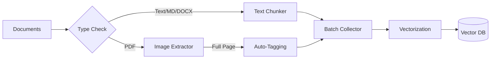

# 🤖 Simple RAG System

A **production-ready** Retrieval-Augmented Generation (RAG) system engineered for high-performance document processing.

It handles **End-to-End** flow: from raw documents (PDF, DOCX, MD) to intelligent chunking, vectorization, and accurate semantic search.


---

## ✨ Key Features

| Feature | Description |
|---------|-------------|
| **🧠 Intelligent Chunking** | Optimized recursive splitting for text (TXT, MD, PDF, DOCX) to preserve context. |
| **⚡ High-Perf Vectorization** | Uses `Alibaba-NLP/gte-multilingual-base` (768-dim) for SOTA multilingual embedding quality. |
| **🔍 Hybrid Search** | **Semantic Search** (Vector) + **Keyword Boosting** (Tags) for maximum accuracy. |
| **🖼️ Smart Image Extraction** | Converts full PDF pages to images, analyzes layout, and automatically **extracts tags** (e.g., `Figure 4.1`, `Table 2`) to boost retrieval. |
| **📊 Dual Backend** | Flexible support for **FAISS** (Speed) or **ChromaDB** (Features). |
| **📈 Sequence Charts** | Special support for **Mermaid** diagrams: parsing, rendering, and vectorizing process flows. |

## 🚀 Quick Start

### 1. Installation

```bash
# Clone the repo
git clone <your-repo-url>
cd simple-rag

# Create virtual env
python -m venv .venv
source .venv/bin/activate  # or .venv\Scripts\activate on Windows

# Install dependencies
pip install -r requirements.txt
pip install pymupdf paddlepaddle  # Core engines
```

### 2. Prepare Data

Put your documents in the data folder:

```text
data/documents/
  ├── internal_report.pdf
  ├── api_specs.md
  └── research_paper.docx
```

### 3. Process Everything (The Magic Command)

Run the all-in-one processing pipeline. This will:

1. Chunk text from documents.
2. Extract full-page images from PDFs (if they contain figures).
3. Auto-generate tags for images (e.g., "Figure 1.1").
4. Vectorize everything in a single optimized batch.

```bash
python -m src.main process --input data/documents --fullpage --no-charts
```

### 4. Search

Query your knowledge base. The system matches both semantic meaning and specific tags.

```bash
# General question
python -m src.main search "what is the system architecture?"

# Specific target (High precision due to auto-tagging)
python -m src.main search "Figure 4.1"
```

---

## 🛠️ CLI Command Reference

| Command | Action | Example |
| :--- | :--- | :--- |
| **`process`** | Ingest & Index documents | `python -m src.main process -fp` |
| **`search`** | Query the database | `python -m src.main search "query"` |
| **`list`** | Show all indexed Docs | `python -m src.main list` |
| **`listtag`** | View tags for a pic | `python -m src.main listtag picname` |
| **`addtag`** | Add tag & **Re-embed** | `python -m src.main addtag picname "new-tag"` |
| **`stats`** | View DB size/status | `python -m src.main stats` |
| **`clean`** | Reset database | `python -m src.main clean --yes` |
| **`init`** | Setup folder structure | `python -m src.main init` |

---

## 🏗️ Architecture

### Data Processing Pipeline



### Image Intelligence

The system doesn't just treat images as files. It understands them:

1. **Detection**: Scans PDF pages for embedded images or vector drawings.
2. **Extraction**: Captures the *entire page* context (`--fullpage` mode).
3. **Tagging**: Regex scans the page text for patterns like `Figure X.Y`, `Table Z`.
4. **Boosting**: These tags are repeated in the vector embedding to ensure `search "Figure 4.1"` hits exactly that image.
5. **Dynamic Re-embedding**: When you use `addtag`, the system:
    - Appends the new tag to the content.
    - **Re-calculates** the vector embedding immediately.
    - Updates the database, making the new tag searchable via semantic search (not just metadata filter).

---

## ⚙️ Configuration

Customize the core engines in `config/settings.py`:

* **Model**: Change embedding models (`gte-multilingual`, `all-MiniLM-L6-v2`, etc.).
* **VectorDB**: Switch between `faiss` (default) and `chromadb`.
* **Chunking**: Adjust `chunk_size` (default: 512) and `overlap`.

## 📁 Project Structure

```text
simple-rag/
├── config/             # Settings & Global configs
├── data/               # Your Data (Docs, DBs, Images)
├── src/
│   ├── chunking/       # Text splitters (LangChain based)
│   ├── image_extraction/ # PDF/Image processing (PyMuPDF)
│   ├── search/         # Search Algo & Ranking
│   ├── vectorization/  # Embedding Engines
│   └── main.py         # CLI Entry point
└── tests/              # Pytest suite
```

## 📄 License

MIT License. Created by Phung Duc Vu.
