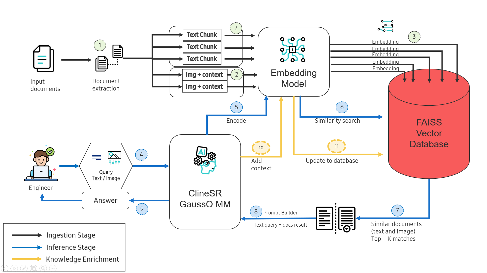

# 🚀 SpecRAG

**High-performance RAG for Technical Specifications**

> Turn your PDF specs into a searchable knowledge base that AI agents can query instantly.


---

## ✨ Why SpecRAG?

| Feature | Description |
|---------|-------------|
| 🎯 **Spec-Optimized** | Auto-detects `Figure X.Y`, `Table X.Y` captions in technical docs |
| 🖼️ **Full-Page Context** | Captures entire page + 10,000 chars of text context |
| 🔀 **Hybrid Search** | Semantic + BM25 exact match with RRF fusion |
| 👁️ **Vision-Ready** | Returns image paths for AI agents to analyze diagrams |
| 🏷️ **Self-Improving** | Tag images → Auto re-embed → Better future searches |

---

## 🚀 Quick Start

```bash
# 1. Setup
git clone <repo-url> && cd SpecRAG
python -m venv .venv && .venv\Scripts\activate
pip install -r requirements.txt

# 2. Process documents
cp your-specs/*.pdf data/documents/
python -m src.main process -fp

# 3. Search
python -m src.main search "authentication flow"
```

---

## 🔍 Search Types

Choose the right search for your question:

| Question Type | Command | Example |
|---------------|---------|---------|
| **Conceptual** | `search` | `search "what is HID protocol"` |
| **Exact match** | `search -hy` | `search -hy "Figure 4.1"` |
| **Find diagrams** | `search -pic` | `search -pic "state machine"` |
| **Complex query** | `msearch` | `msearch "reconnect" "link loss" "timeout"` |

**Combine them:** `search -pic -hy "Figure 4.1"` finds the exact diagram.

> 📖 **Deep dive:** [Search Guide](docs/guides/searching.md)

---

## 🛠️ Core Commands

```bash
# Process
python -m src.main process -fp          # Full-page extraction (recommended)
python -m src.main process -dl          # Docling AI extraction

# Search  
python -m src.main search "query"       # Semantic search
python -m src.main search -hy "query"   # Hybrid (exact + semantic)
python -m src.main search -pic "query"  # Images only
python -m src.main msearch "q1" "q2"    # Multi-query with RRF

# Improve
python -m src.main addtag ID "tag"      # Add tag (triggers re-embed)
python -m src.main addknowledge ID "text" # Add description

# Manage
python -m src.main list                 # Show indexed documents
python -m src.main stats                # Database statistics
python -m src.main clean --yes          # Reset everything
```

> 📖 **Full reference:** [CLI Commands](docs/reference/cli-commands.md)

---

## 🏗️ How It Works



### Three-Stage Pipeline

| Stage | Steps | Description |
|-------|-------|-------------|
| **⬛ Ingestion** | 1→3 | Documents are chunked, images extracted with context, then embedded into FAISS |
| **🔵 Inference** | 4→9 | User query → encode → similarity search → retrieve Top-K → build prompt → answer |
| **🟡 Knowledge Enrichment** | 10→11 | Add tags/descriptions → re-embed → improve future searches |

### Tech Stack

| Component | Technology |
|-----------|------------|
| Embedding | `Alibaba-NLP/gte-multilingual-base` (768-dim) |
| Vector DB | FAISS (IndexFlatIP, cosine similarity) |
| PDF Processing | PyMuPDF (fitz) |
| Layout Detection | Docling (RT-DETR model) |

> 📖 **Architecture details:** [Overview](docs/architecture/overview.md)

---

## 🤖 Cline Integration

SpecRAG includes ready-to-use rules for **Cline** AI agent in `.clinerules/`:

```
.clinerules/
├── rule_rag_backend.md        # Core rules: search first, no manual PDF reading
└── workflows/
    ├── workflow_rag_backend.md      # Standard search → analyze → answer
    └── workflow_rag_with_knowledge.md # Use pre-analyzed knowledge
```

**How it works:** Cline automatically searches RAG before answering, analyzes images with vision, and adds tags to improve future searches.

> 📖 **Setup guide:** [Cline Integration](docs/integrations/cline.md)

---

## 📁 Project Structure

```
SpecRAG/
├── .clinerules/          # AI agent rules & workflows
├── config/               # Settings (Pydantic)
├── data/
│   ├── documents/        # Input PDFs
│   ├── extracted_images/ # Output images
│   └── faiss_index/      # Vector database
├── docs/                 # Documentation
├── src/                  # Source code
│   ├── chunking/         # Text splitting
│   ├── image_extraction/ # PDF image extraction
│   ├── search/           # Search algorithms
│   ├── vectorization/    # Embedding & FAISS
│   └── main.py           # CLI entry point
└── tests/
```

---

## 📚 Documentation

| | |
|---|---|
| **[Getting Started](docs/getting-started/)** | Installation, Quickstart, Basic Workflow |
| **[Guides](docs/guides/)** | Processing, Searching, Tagging, Knowledge |
| **[Reference](docs/reference/)** | CLI Commands, Configuration |
| **[Architecture](docs/architecture/)** | System Overview, Image Extraction, Search Engine |
| **[Integrations](docs/integrations/)** | Cline AI Agent |

---

## 📄 License

MIT License. Created by **Phung Duc Vu**.
