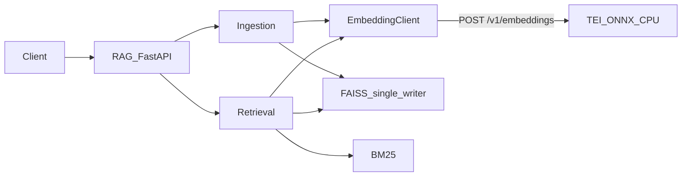

# Kiến trúc SpecRAG

SpecRAG gồm hai deployable độc lập. Embedding service là stateless compute;
RAG service sở hữu toàn bộ dữ liệu và nghiệp vụ retrieval.



## Embedding service

- Runtime: TEI CPU với model ONNX đã export.
- Model: `Alibaba-NLP/gte-multilingual-base`.
- Contract: CLS pooling, L2 normalization, 768 dimensions, tối đa 8192 token.
- Sở hữu tokenizer, truncation, batching và model lifecycle.
- Không biết chunk ID, metadata, FAISS hoặc nghiệp vụ search.

Chi tiết export và validation nằm tại
[`services/embedding/README.md`](../../services/embedding/README.md).

## RAG service

- API: `src/specrag/api/`
- CLI: `src/specrag/cli/`
- Ingestion: `src/specrag/ingestion/`
- Embedding HTTP client: `src/specrag/embedding/`
- Semantic/hybrid retrieval: `src/specrag/search/`
- FAISS vector store and persistence: `src/specrag/vectorization/`
- Document readers/chunking: `src/specrag/chunking/`

RAG không cài Torch, Transformers, Sentence Transformers hoặc ONNX Runtime.
Mọi thao tác tạo vector, bao gồm search, ingest và cập nhật tag/knowledge, đều
đi qua `EmbeddingProvider`.

## Dữ liệu và concurrency

FAISS, metadata và source documents thuộc RAG data volume. Mỗi volume chỉ có
một RAG writer. Process lock chặn writer thứ hai; thread lock bảo vệ search và
mutation trong process. Persistence dùng temp file, `fsync` và atomic rename.

`specrag reindex` build index trong staging directory. Live index chỉ bị thay
thế sau khi toàn bộ extract/embed/store thành công.

## Model compatibility

Index summary lưu fingerprint:

```text
model_id@revision:variant:pooling:normalization:dimension
```

Readiness và ingest từ chối model có dimension/fingerprint khác index. Khi đổi
model, revision, pooling hoặc quantization có ảnh hưởng chất lượng, chạy parity,
Recall@K/NDCG@K rồi re-index.

## Runtime

`compose.yaml` khởi động:

1. `embedding`: internal-only port 80, model volume read-only.
2. `rag`: public port 10000, chỉ start sau khi embedding healthy.

RAG cung cấp `/health`, `/api/v1/ready`, `/metrics` và request ID. Không scale
RAG ngang khi còn dùng FAISS local; nếu cần nhiều replica/writer, chuyển storage
sang Qdrant hoặc pgvector.
