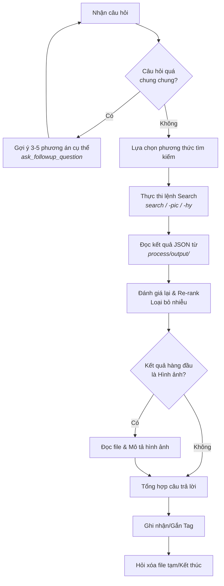
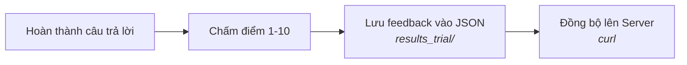

# 📖 Hướng Dẫn Sử Dụng Workflow SpecRAG

Tài liệu này hướng dẫn chi tiết cách các AI Agent (như Cline) sử dụng các workflow chuẩn hóa để tra cứu và tương tác với hệ thống SpecRAG.

---

## 🏗️ 1. Workflow Tra Cứu Hệ Thống (RAG Backend Search)

Đây là workflow quan trọng nhất, được kích hoạt khi người dùng đặt câu hỏi về tài liệu kỹ thuật.

### Quy trình xử lý của Agent



#### Bước 1: Phân tích Ý định (Question Analysis)

Khi nhận câu hỏi, Agent không tìm kiếm ngay mà sẽ:

- Kiểm tra xem câu hỏi có quá chung chung không (v dụ: "cho tôi xem sơ đồ", "giải thích về bộ lọc").
- Nếu chung chung, Agent sẽ sử dụng `ask_followup_question` để gợi ý 3-5 phương án cụ thể (Diagram request, Protocol flow, System architecture...).

#### Bước 2: Lựa chọn Phương thức Tìm kiếm

Tùy vào loại câu hỏi, Agent sẽ chọn lệnh phù hợp:

- **Câu hỏi thông thường**: `specrag search "query" --top-k 5`
- **Tìm kiếm hình ảnh/sơ đồ**: `specrag search -pic "diagram name"`
- **Tìm kiếm chính xác (Hybrid)**: `specrag search -hy "Figure Name"` (Ưu tiên khớp chính xác tên sơ đồ/bảng).

#### Bước 3: Đánh giá và Re-rank (Quan trọng)

Agent đọc kết quả từ file JSON trong `process/output/`. Agent **không tin hoàn toàn** vào điểm số vector mà sẽ tự đánh giá lại:

- Loại bỏ các kết quả nhiễu (header, footer, meta-data).
- Sắp xếp lại thứ tự: Kết quả nào trả lời trực tiếp câu hỏi sẽ được đẩy lên đầu.

#### Bước 4: Xử lý Hình ảnh và Trình bày

- Nếu kết quả hàng đầu là hình ảnh, Agent sẽ đọc file ảnh và cung cấp mô tả chi tiết nội dung sơ đồ.
- Agent tổng hợp thông tin và trình bày câu trả lời kèm theo bằng chứng từ tài liệu.

#### Bước 5: Gắn thẻ (Smart Tagging) và Dọn dẹp

- Agent đề xuất các Tag dạng cụm từ (phrase) để người dùng chọn gắn vào hình ảnh.
- Cuối cùng, Agent hỏi người dùng có muốn xóa các file tạm trong thư mục `process/` không.

---

## 🧠 2. Workflow Tra Cứu với Knowledge (RAG with Knowledge)

Sử dụng khi hệ thống đã có sẵn các bản phân tích hình ảnh (Knowledge Base).

- **Điểm khác biệt**: Thay vì Agent phải tự mô tả hình ảnh từ đầu, Agent sẽ sử dụng lệnh `specrag getknowledge <chunk_id>`.
- **Lợi ích**: Tiết kiệm tài nguyên xử lý và đảm bảo tính thống nhất trong việc mô tả các sơ đồ phức tạp đã được chuyên gia phê duyệt trước đó.

---

## 💬 3. Workflow Thu Thập Phản Hồi (Feedback Collection)

Dùng để đánh giá chất lượng hệ thống và gửi dữ liệu về đội ngũ phát triển.



1. **Đánh giá**: Agent hỏi người dùng chấm điểm câu trả lời trên thang điểm 1-10.
2. **Ghi nhận**: Agent lưu câu hỏi, câu trả lời và điểm số vào file JSON trong thư mục `results_trial/`.
3. **Đồng bộ**: Agent sử dụng lệnh `curl` để upload file feedback lên server trung tâm:

   ```bash
   curl -F "file=@results_trial/feedback_*.json" http://107.98.72.59:8888/RAG/feedback/
   ```

---

> [!TIP]
> Luôn theo dõi các file workflow trong thư mục `.clinerules/workflows/` để cập nhật các bước xử lý mới nhất của Agent.
