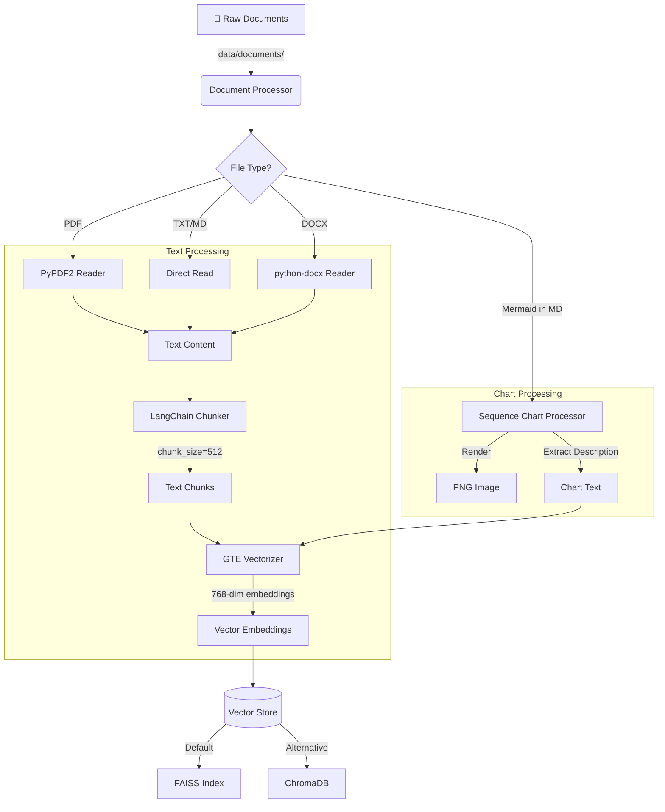
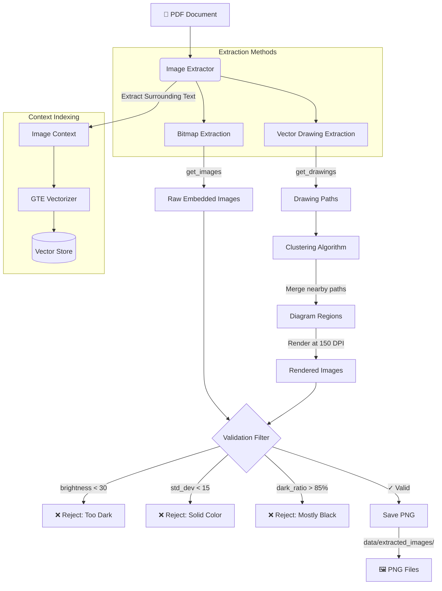
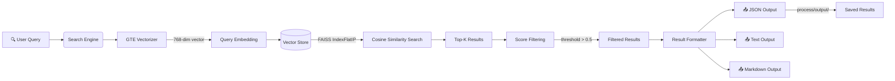
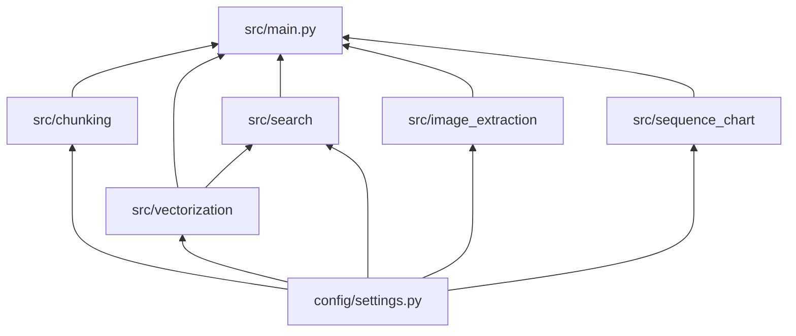

# Project Workflows

This document provides detailed technical documentation of the data pipelines and workflows in the Simple RAG System.

---

## 1. Document Ingestion Pipeline

**Command:** `python -m src.main process`

This pipeline processes raw documents into searchable vector embeddings.

### Flow Diagram



### Technical Details

| Step | Module | Description |
|------|--------|-------------|
| 1. File Reading | `src/chunking/chunker.py` | Reads PDF (PyPDF2), DOCX (python-docx), TXT/MD |
| 2. Chunking | `src/chunking/chunker.py` | LangChain `RecursiveCharacterTextSplitter` |
| 3. Vectorization | `src/vectorization/vectorizer.py` | SentenceTransformer with GTE model |
| 4. Storage | `src/vectorization/faiss_store.py` | FAISS IndexFlatIP for cosine similarity |

### Configuration

```python
# config/settings.py
ChunkingConfig:
    chunk_size = 512       # Characters per chunk
    chunk_overlap = 50     # Overlap between chunks
    separators = ["\n\n", "\n", ". ", " ", ""]
```

---

## 2. Image Extraction Pipeline

**Integrated into:** `python -m src.main process`

This pipeline extracts figures, diagrams, and charts from PDF documents (runs automatically as part of `process` unless `--no-images` is specified).

### Flow Diagram



### Technical Details

| Step | Method | Description |
|------|--------|-------------|
| 1. Bitmap Extraction | `page.get_images()` | Extracts embedded raster images |
| 2. Vector Drawing | `page.get_drawings()` | Detects vector graphics paths |
| 3. Clustering | Single-pass merge | Groups nearby drawing paths (50px threshold) |
| 4. Alpha Handling | Composite on white | Prevents transparent → black conversion |
| 5. Validation | Statistical analysis | Filters invalid images by brightness/variance |

### Validation Thresholds

```python
# src/image_extraction/extractor.py
ImageExtractionConfig:
    min_width = 50              # Minimum image width (pixels)
    min_height = 50             # Minimum image height (pixels)
    min_brightness = 30.0       # Mean brightness threshold (0-255)
    min_std_dev = 15.0          # Variance threshold
    max_dark_pixel_ratio = 0.85 # Max % of dark pixels allowed
```

### Output Naming Convention

```
{source_file}_p{page_number}_img{index}_{hash}.png
{source_file}_p{page_number}_drawing{index}_{hash}.png

Example: HFP_v1.8_p28_img1_3203447e.png
```

---

## 3. Search Workflow

**Command:** `python -m src.main search "<query>"`

### Flow Diagram



### Technical Details

| Step | Description |
|------|-------------|
| 1. Query Vectorization | Same GTE model used for document vectorization |
| 2. Similarity Search | FAISS inner product on L2-normalized vectors |
| 3. Score Conversion | For cosine: similarity = dot product (already normalized) |
| 4. Result Ranking | Sorted by similarity score, descending |

### Search Parameters

```python
# config/settings.py
SearchConfig:
    top_k = 5                  # Number of results to return
    score_threshold = 0.5      # Minimum similarity score
    include_metadata = True    # Include source info in results
```

---

## 4. Operational Commands

### Initialize Project

```bash
python -m src.main init
# Creates: data/, models/, process/ directories
```

### Process Documents

```bash
# Process all: text + images + charts
python -m src.main process

# Custom input directory
python -m src.main process --input /path/to/documents

# Skip image extraction
python -m src.main process --no-images

# Skip Mermaid chart processing
python -m src.main process --no-charts
```

### Search

```bash
# Basic search
python -m src.main search "your query here"

# With options
python -m src.main search "query" --top-k 10 --no-save
```

### View Statistics

```bash
python -m src.main stats
# Shows: vector count, index type, dimension, storage path
```

### Clean Data

```bash
# Clean with confirmation
python -m src.main clean

# Skip confirmation
python -m src.main clean -y

# Clean everything including downloaded models (~1.5GB)
python -m src.main clean --all -y
```

---

## 5. Module Dependencies



### Key Dependencies

| Module | External Libraries |
|--------|-------------------|
| `chunking` | langchain-text-splitters, PyPDF2, python-docx |
| `vectorization` | sentence-transformers, faiss-cpu, chromadb |
| `search` | numpy |
| `image_extraction` | PyMuPDF (fitz), Pillow, numpy |
| `sequence_chart` | (built-in Mermaid parser) |

---

## 6. Data Flow Summary

```
Input Documents                    Vector Store                 Search Results
     │                                  │                              │
     ▼                                  ▼                              ▼
┌─────────────┐   Chunk    ┌─────────────────┐   Query   ┌─────────────────┐
│ PDF/TXT/MD  │ ────────▶ │ FAISS/ChromaDB  │ ────────▶ │ Ranked Results  │
│ DOCX        │  Vectorize │ 768-dim vectors │  Search   │ + Metadata      │
└─────────────┘            └─────────────────┘           └─────────────────┘
     │                                  ▲
     │ Extract                          │
     ▼                                  │
┌─────────────┐                         │
│ PNG Images  │ ─── Vectorize Context ──┘
│ from PDFs   │
└─────────────┘
```
