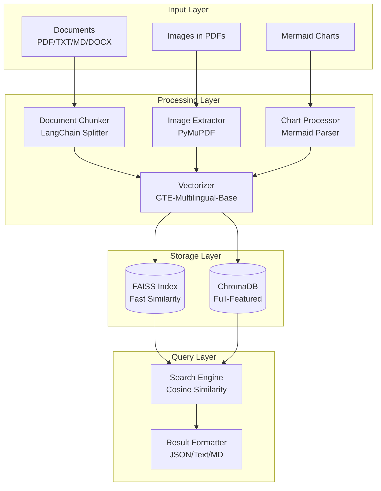
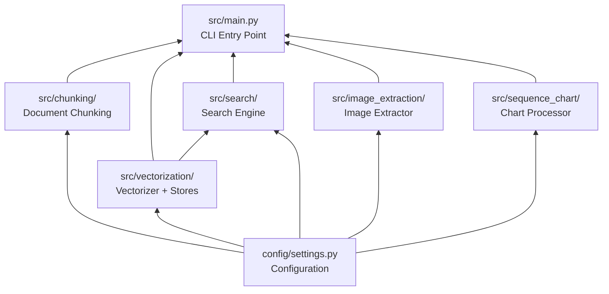
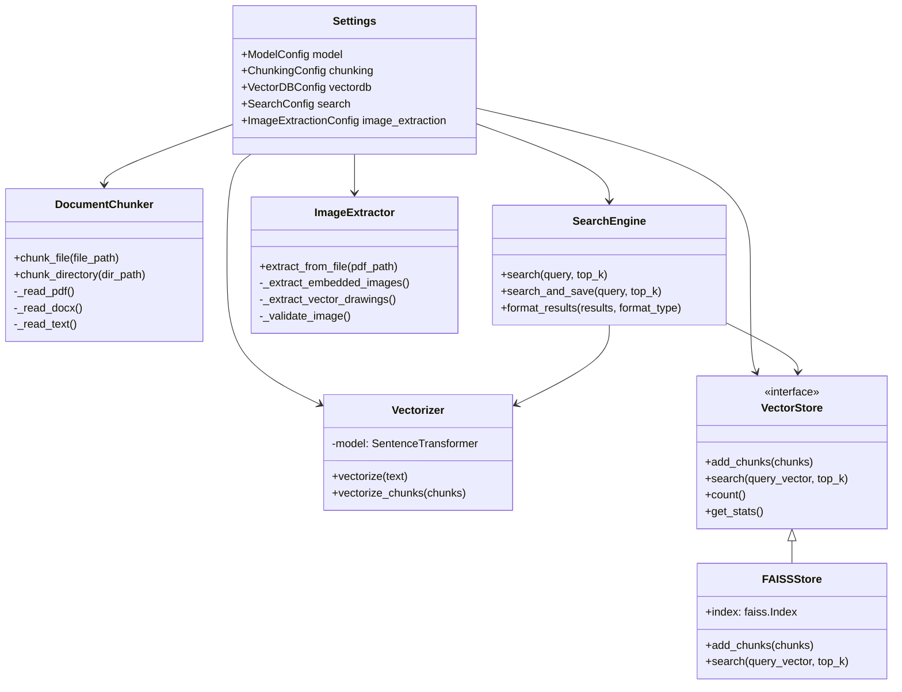
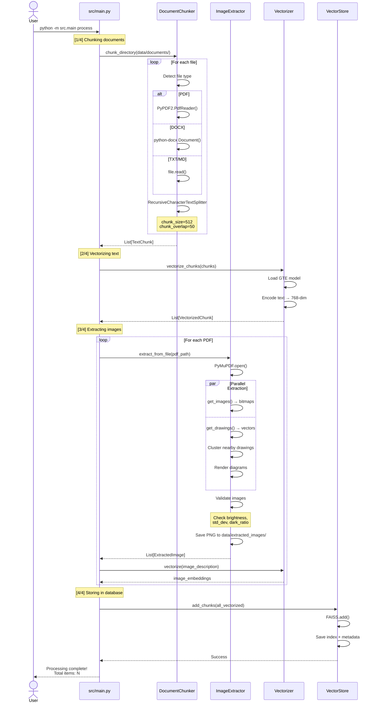
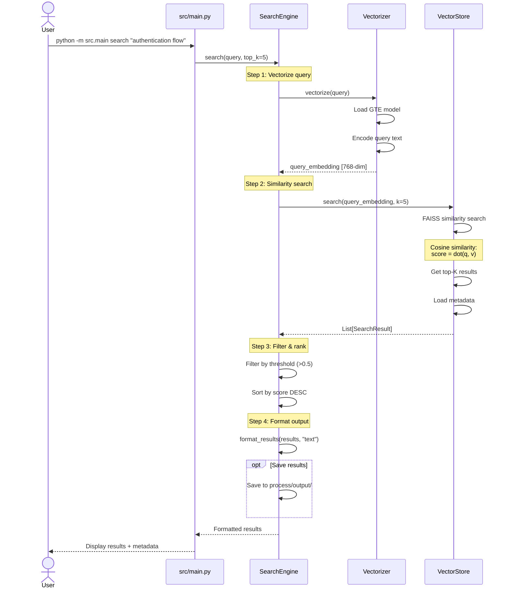
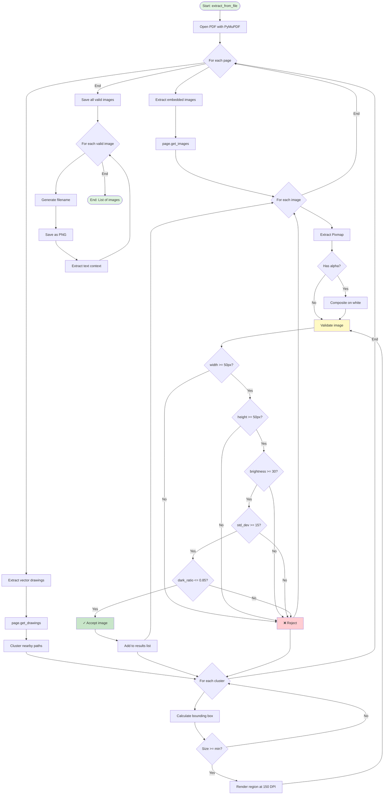
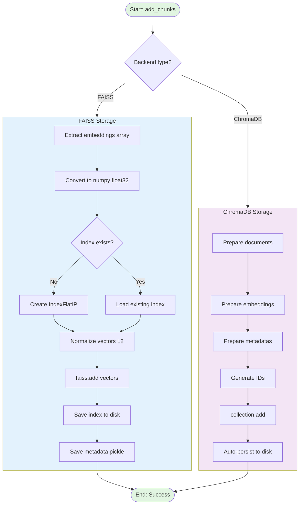

# Simple RAG System - Basic Information & Code Flow

## 📋 Table of Contents

1. [Project Overview](#project-overview)
2. [Architecture](#architecture)
3. [Code Flow](#code-flow)
4. [Detailed Component Documentation](#detailed-component-documentation)
5. [Data Structures](#data-structures)
6. [Key Algorithms](#key-algorithms)

---

## 🎯 Project Overview

### Mục đích

Hệ thống **RAG (Retrieval-Augmented Generation)** production-ready được thiết kế để:
- Xử lý và lập chỉ mục các tài liệu (PDF, TXT, MD, DOCX)
- Trích xuất hình ảnh và biểu đồ từ PDF
- Tìm kiếm ngữ nghĩa (semantic search) hiệu quả
- Cung cấp context cho các LLM models

### Tính năng chính

| Tính năng | Mô tả | Công nghệ |
|-----------|-------|-----------|
| **Document Processing** | Đọc và xử lý nhiều định dạng tài liệu | PyPDF2, python-docx, LangChain |
| **Text Chunking** | Chia nhỏ tài liệu thành chunks tối ưu | LangChain RecursiveCharacterTextSplitter |
| **Vectorization** | Chuyển đổi text thành embeddings 768-dim | Alibaba-NLP/gte-multilingual-base |
| **Image Extraction** | Trích xuất hình ảnh từ PDF (embedded + vector) | PyMuPDF (fitz) |
| **Vector Storage** | Lưu trữ và quản lý vectors | FAISS (fast) / ChromaDB (full-featured) |
| **Semantic Search** | Tìm kiếm dựa trên ý nghĩa, không phải từ khóa | Cosine similarity |
| **Sequence Charts** | Xử lý Mermaid diagrams | Custom parser |

### Tech Stack

```
Backend:
├── Python 3.x
├── PyTorch (>=2.0.0)
├── Transformers (>=4.35.0)
├── Sentence-Transformers (>=2.2.0)
└── LangChain (>=0.1.0)

Vector Databases:
├── FAISS (faiss-cpu >=1.7.4)
└── ChromaDB (>=0.4.0)

Document Processing:
├── PyPDF2 (>=3.0.0) - PDF text extraction
├── PyMuPDF (>=1.23.0) - PDF image extraction
├── python-docx (>=0.8.11) - DOCX handling
└── Pillow (>=10.0.0) - Image processing

ML Model:
└── Alibaba-NLP/gte-multilingual-base
    - 768-dimensional embeddings
    - Multi-language support
    - Max sequence length: 8192
```

### Cấu trúc thư mục

```
simple-rag/
├── config/                     # ⚙️ Configuration
│   └── settings.py             # All system settings
│
├── data/                       # 💾 Data storage
│   ├── documents/              # 📥 Input: Source documents (PDF, TXT, MD, DOCX)
│   ├── extracted_images/       # 📤 Output: Extracted images from PDFs
│   ├── vectordb/               # 🗄️ ChromaDB storage
│   └── faiss_index/            # 🗄️ FAISS index + metadata
│
├── models/                     # 🤖 Downloaded ML models (~1.5GB)
│   └── Alibaba-NLP/gte-multilingual-base/
│
├── process/                    # 📊 Processing logs
│   ├── input/                  # Search query logs
│   └── output/                 # Search result logs
│
├── src/                        # 💻 Source code
│   ├── chunking/               # Document chunking
│   │   └── chunker.py
│   ├── vectorization/          # Text → embeddings
│   │   ├── vectorizer.py       # Embedding generator
│   │   ├── vector_store.py     # Abstract interface
│   │   ├── faiss_store.py      # FAISS implementation
│   │   └── __init__.py
│   ├── search/                 # Search engine
│   │   └── engine.py
│   ├── image_extraction/       # PDF image extraction
│   │   └── extractor.py
│   ├── sequence_chart/         # Mermaid chart processing
│   │   └── processor.py
│   └── main.py                 # CLI entry point
│
├── tests/                      # 🧪 Unit tests
│   ├── test_chunking.py
│   └── test_sequence_chart.py
│
├── requirements.txt            # Dependencies
├── pyproject.toml             # Project metadata
└── README.md                  # Documentation
```

---

## 🏗️ Architecture

### High-Level Architecture



### Module Dependencies



### Component Relationships



---

## 🔄 Code Flow

### 1. Process Workflow

**Command:** `python -m src.main process`

**Mục đích:** Xử lý tài liệu và tạo vector index



### 2. Search Workflow

**Command:** `python -m src.main search "query"`

**Mục đích:** Tìm kiếm ngữ nghĩa trong vector database



### 3. Detailed Processing Steps

#### 3.1 Document Chunking Process

```mermaid
flowchart TD
    START([Start: chunk_directory]) --> SCAN[Scan data/documents/]
    SCAN --> LOOP{For each file}
    
    LOOP -->|PDF| PDF[Read with PyPDF2]
    LOOP -->|DOCX| DOCX[Read with python-docx]
    LOOP -->|TXT/MD| TXT[Read as text]
    LOOP -->|End| RETURN[Return all chunks]
    
    PDF --> EXTRACT_TEXT[Extract text content]
    DOCX --> EXTRACT_TEXT
    TXT --> EXTRACT_TEXT
    
    EXTRACT_TEXT --> SPLITTER[LangChain TextSplitter]
    
    SPLITTER --> SPLIT{Split by separators}
    SPLIT -->|1st try| SEP1["\\n\\n (paragraphs)"]
    SEP1 -->|Too large?| SEP2["\\n (lines)"]
    SEP2 -->|Too large?| SEP3[". (sentences)"]
    SEP3 -->|Too large?| SEP4[" (words)"]
    SEP4 -->|Too large?| SEP5["" (chars)"]
    
    SEP1 --> CHECK_SIZE{Size OK?}
    SEP2 --> CHECK_SIZE
    SEP3 --> CHECK_SIZE
    SEP4 --> CHECK_SIZE
    SEP5 --> CHECK_SIZE
    
    CHECK_SIZE -->|Yes| ADD_CHUNK[Add chunk with metadata]
    CHECK_SIZE -->|No| SPLIT
    
    ADD_CHUNK --> OVERLAP[Add overlap from previous chunk]
    OVERLAP --> LOOP
    
    RETURN --> END([End: List of chunks])
    
    style START fill:#e1f5e1
    style END fill:#e1f5e1
    style SPLITTER fill:#fff4e6
    style ADD_CHUNK fill:#e3f2fd
```

#### 3.2 Image Extraction Process



#### 3.3 Vector Storage Process



---

## 📦 Detailed Component Documentation

### 1. Configuration Module

**File:** `config/settings.py`

**Purpose:** Quản lý tất cả cấu hình hệ thống

#### Classes:

##### ModelConfig
```python
class ModelConfig(BaseModel):
    model_name: str = "models/models--Alibaba-NLP--gte-multilingual-base/..."
    model_cache_dir: Path = MODELS_DIR
    max_seq_length: int = 8192      # Max tokens per input
    device: str = "cpu"              # "cpu" or "cuda"
    normalize_embeddings: bool = True
```

##### ChunkingConfig
```python
class ChunkingConfig(BaseModel):
    chunk_size: int = 512            # Characters per chunk
    chunk_overlap: int = 50          # Overlap between chunks
    separators: list[str] = ["\n\n", "\n", ". ", " ", ""]
    length_function: str = "len"     # or "tiktoken"
```

##### VectorDBConfig
```python
class VectorDBConfig(BaseModel):
    backend: str = "faiss"           # "faiss" or "chromadb"
    collection_name: str = "documents"
    persist_directory: Path = VECTORDB_DIR
    faiss_index_dir: Path = FAISS_INDEX_DIR
    distance_metric: str = "cosine"  # "cosine", "l2", "ip"
    faiss_index_type: str = "Flat"   # "Flat", "IVF", "HNSW"
```

##### ImageExtractionConfig
```python
class ImageExtractionConfig(BaseModel):
    # Output settings
    output_dir: Path = EXTRACTED_IMAGES_DIR
    image_format: str = "png"
    
    # Size filters
    min_width: int = 50
    min_height: int = 50
    
    # Quality filters
    min_brightness: float = 30.0      # Mean brightness (0-255)
    min_std_dev: float = 15.0         # Standard deviation
    max_dark_pixel_ratio: float = 0.85
    
    # Extraction options
    extract_tables: bool = True
    extract_figures: bool = True
    context_chars: int = 500          # Context around image
    
    # PyMuPDF settings
    cluster_merge_distance: int = 50   # Pixels to merge drawings
    min_drawing_size: int = 20
    min_diagram_size: int = 100
```

---

### 2. Document Chunker

**File:** `src/chunking/chunker.py`

**Purpose:** Chia nhỏ documents thành chunks phù hợp cho vectorization

#### Key Methods:

```python
class DocumentChunker:
    def chunk_file(self, file_path: Path) -> List[Dict]:
        """
        Chunk một file duy nhất.
        
        Returns:
            List of dicts with keys:
            - content: str (chunk text)
            - metadata: dict (source, page, chunk_id)
        """
        
    def chunk_directory(self, dir_path: Path) -> List[Dict]:
        """
        Chunk tất cả files trong directory.
        Supports: .pdf, .txt, .md, .docx
        """
```

#### Internal Flow:

1. **File Type Detection**
   - `.pdf` → `_read_pdf()` with PyPDF2
   - `.docx` → `_read_docx()` with python-docx
   - `.txt`, `.md` → `_read_text()` direct read

2. **Text Splitting**
   - Uses LangChain `RecursiveCharacterTextSplitter`
   - Tries separators in order: `\n\n`, `\n`, `. `, ` `, ``
   - Maintains `chunk_overlap` for context continuity

3. **Metadata Addition**
   - `source`: Original filename
   - `page`: Page number (for PDF)
   - `chunk_id`: Sequential ID
   - `chunk_index`: Index within document

#### Input/Output:

```
Input:  data/documents/*.{pdf,txt,md,docx}
Output: List[Dict]
        [
            {
                "content": "Text content of chunk...",
                "metadata": {
                    "source": "document.pdf",
                    "page": 1,
                    "chunk_id": "doc_0",
                    "chunk_index": 0
                }
            },
            ...
        ]
```

---

### 3. Vectorizer

**File:** `src/vectorization/vectorizer.py`

**Purpose:** Chuyển đổi text thành vector embeddings

#### Key Methods:

```python
class Vectorizer:
    def __init__(self):
        """Load SentenceTransformer model (lazy loading)"""
        
    def vectorize(self, texts: Union[str, List[str]]) -> np.ndarray:
        """
        Vectorize text(s) thành embeddings.
        
        Args:
            texts: Single string hoặc list of strings
            
        Returns:
            numpy array shape (n_texts, 768)
        """
        
    def vectorize_chunks(self, chunks: List[Dict]) -> List[Dict]:
        """
        Vectorize list of chunks, add embedding vào metadata.
        
        Returns:
            Same chunks with added "embedding" key
        """
```

#### Technical Details:

- **Model**: Alibaba-NLP/gte-multilingual-base
- **Dimension**: 768
- **Max Length**: 8192 tokens
- **Normalization**: L2 normalized (for cosine similarity)
- **Batch Processing**: Processes multiple texts efficiently

#### Input/Output:

```
Input:  "This is a sample text"
Output: np.array([0.123, -0.456, 0.789, ...])  # shape: (768,)

Input:  ["text1", "text2"]
Output: np.array([[...], [...]])  # shape: (2, 768)
```

---

### 4. Vector Store (FAISS)

**File:** `src/vectorization/faiss_store.py`

**Purpose:** Lưu trữ và tìm kiếm vectors với FAISS

#### Key Methods:

```python
class FAISSStore(VectorStore):
    def add_chunks(self, chunks: List[Dict]):
        """
        Add chunks vào FAISS index.
        Saves both index and metadata.
        """
        
    def search(self, query_vector: np.ndarray, top_k: int = 5) -> List[Dict]:
        """
        Search similar vectors.
        
        Returns:
            List of dicts with:
            - content: Original text
            - metadata: Source info
            - score: Similarity score
            - distance: Distance metric
        """
        
    def count(self) -> int:
        """Return total number of vectors"""
        
    def get_stats(self) -> Dict:
        """Return index statistics"""
```

#### FAISS Index Types:

| Type | Speed | Accuracy | Use Case |
|------|-------|----------|----------|
| **Flat** | ⭐⭐ | ⭐⭐⭐ (exact) | < 100K vectors |
| **IVF** | ⭐⭐⭐ | ⭐⭐ (approximate) | Large datasets |
| **HNSW** | ⭐⭐⭐ | ⭐⭐⭐ | Balanced |

#### Storage Format:

```
data/faiss_index/
├── documents.index          # FAISS index binary
└── documents_metadata.pkl   # Pickled metadata
```

#### Similarity Calculation:

```python
# Cosine similarity using Inner Product on normalized vectors
# score = dot(query_vector, doc_vector)
# Range: [-1, 1], higher is more similar
```

---

### 5. Search Engine

**File:** `src/search/engine.py`

**Purpose:** Semantic search interface

#### Key Methods:

```python
class SearchEngine:
    def search(self, query: str, top_k: int = 5) -> List[Dict]:
        """
        Perform semantic search.
        
        Steps:
        1. Vectorize query
        2. Search in vector store
        3. Filter by threshold
        4. Return ranked results
        """
        
    def search_and_save(self, query: str, top_k: int = 5) -> List[Dict]:
        """
        Search and save query + results to process/ directory
        """
        
    def format_results(self, results: List[Dict], format_type: str) -> str:
        """
        Format results as "text", "json", or "markdown"
        """
```

#### Search Process:

1. **Query Vectorization**
   ```python
   query_vec = vectorizer.vectorize(query)  # shape: (768,)
   ```

2. **Similarity Search**
   ```python
   results = vector_store.search(query_vec, top_k=5)
   ```

3. **Score Filtering**
   ```python
   filtered = [r for r in results if r['score'] > threshold]
   ```

4. **Result Ranking**
   - Already sorted by FAISS (descending score)

#### Output Format:

```json
{
    "query": "authentication flow",
    "results": [
        {
            "content": "Text content of chunk...",
            "metadata": {
                "source": "document.pdf",
                "page": 5,
                "chunk_id": "doc_23"
            },
            "score": 0.87,
            "distance": 0.13
        },
        ...
    ],
    "timestamp": "2024-01-15T10:30:00"
}
```

---

### 6. Image Extractor

**File:** `src/image_extraction/extractor.py`

**Purpose:** Trích xuất hình ảnh và diagrams từ PDF

#### Key Methods:

```python
class ImageExtractor:
    def extract_from_file(self, pdf_path: Path) -> List[Dict]:
        """
        Extract all images from PDF.
        
        Returns:
            List of dicts with:
            - image_path: Path to saved PNG
            - page_num: Page number
            - bbox: Bounding box
            - context: Surrounding text
            - type: "embedded" or "drawing"
        """
        
    def _extract_embedded_images(self, page) -> List:
        """Extract raster images using page.get_images()"""
        
    def _extract_vector_drawings(self, page) -> List:
        """
        Extract vector drawings using page.get_drawings().
        Clusters nearby paths into diagrams.
        """
        
    def _validate_image(self, pix) -> bool:
        """
        Validate image quality.
        Checks: size, brightness, variance, dark ratio
        """
```

#### Extraction Methods:

**Method 1: Embedded Images**
```python
# PyMuPDF extracts embedded raster images
image_list = page.get_images(full=True)
for img in image_list:
    xref = img[0]
    pix = fitz.Pixmap(doc, xref)
    # Validate and save
```

**Method 2: Vector Drawings**
```python
# Extract drawing paths
drawings = page.get_drawings()

# Cluster nearby paths
clusters = cluster_drawings(drawings, merge_distance=50)

# Render each cluster
for cluster in clusters:
    bbox = calculate_bbox(cluster)
    pix = page.get_pixmap(clip=bbox, dpi=150)
    # Validate and save
```

#### Validation Filters:

```python
def _validate_image(pix) -> bool:
    # 1. Size check
    if pix.width < 50 or pix.height < 50:
        return False
    
    # 2. Brightness check
    mean_brightness = np.mean(pixel_values)
    if mean_brightness < 30:
        return False
    
    # 3. Variance check (avoid solid colors)
    std_dev = np.std(pixel_values)
    if std_dev < 15:
        return False
    
    # 4. Dark pixel ratio
    dark_ratio = np.sum(pixel_values < 50) / total_pixels
    if dark_ratio > 0.85:
        return False
    
    return True
```

#### Output Naming:

```
{filename}_p{page}_img{index}_{hash}.png    # Embedded images
{filename}_p{page}_drawing{index}_{hash}.png  # Vector drawings

Example: HID_v1.1.1_p23_drawing0_36f80925.png
```

---

## 📊 Data Structures

### 1. Text Chunk

```python
{
    "content": str,           # The actual text content
    "metadata": {
        "source": str,        # Original filename
        "page": int,          # Page number (for PDF)
        "chunk_id": str,      # Unique identifier
        "chunk_index": int,   # Index within document
        "type": str           # "text", "image", "chart"
    }
}
```

### 2. Vectorized Chunk

```python
{
    "content": str,
    "metadata": {...},
    "embedding": List[float]  # 768-dimensional vector
}
```

### 3. Search Result

```python
{
    "content": str,           # Matched text
    "metadata": {...},        # Source metadata
    "score": float,           # Similarity score [0-1]
    "distance": float,        # Distance metric
    "rank": int              # Result ranking
}
```

### 4. Extracted Image

```python
{
    "image_path": Path,       # Path to saved PNG
    "page_num": int,          # Source page
    "bbox": tuple,            # (x0, y0, x1, y1)
    "context": str,           # Surrounding text
    "type": str,              # "embedded" or "drawing"
    "width": int,
    "height": int,
    "hash": str               # Content hash
}
```

### 5. FAISS Index Metadata

```python
{
    "vectors": np.ndarray,    # Shape: (n_vectors, 768)
    "documents": List[str],   # Original texts
    "metadatas": List[Dict],  # Per-vector metadata
    "ids": List[str]          # Unique IDs
}
```

---

## 🔬 Key Algorithms

### 1. Text Chunking Strategy

**Algorithm:** Recursive Character Text Splitting

```python
def recursive_split(text, chunk_size, separators):
    """
    Recursively split text using hierarchical separators.
    
    Priority order:
    1. "\n\n" - Paragraphs (preserve semantic units)
    2. "\n"   - Lines
    3. ". "   - Sentences
    4. " "    - Words
    5. ""     - Characters (last resort)
    """
    
    # Try each separator
    for sep in separators:
        chunks = text.split(sep)
        
        # If chunks are small enough, return them
        if all(len(c) <= chunk_size for c in chunks):
            return add_overlap(chunks, chunk_overlap)
        
        # If still too large, try next separator
        continue
    
    # Last resort: hard split by characters
    return hard_split(text, chunk_size)
```

**Benefits:**
- ✅ Preserves semantic boundaries (paragraphs, sentences)
- ✅ Maintains context with overlap
- ✅ Handles various document structures

---

### 2. Vector Drawing Clustering

**Algorithm:** Single-pass proximity clustering

```python
def cluster_drawings(drawings, merge_distance=50):
    """
    Cluster nearby drawing paths into diagrams.
    
    Steps:
    1. Sort drawings by position (top-left to bottom-right)
    2. Initialize first cluster
    3. For each drawing:
       - If close to existing cluster (< merge_distance)
         → Add to cluster
       - Else
         → Create new cluster
    4. Filter clusters by minimum size
    """
    
    clusters = []
    current_cluster = []
    
    for drawing in sorted_drawings:
        if is_nearby(drawing, current_cluster, merge_distance):
            current_cluster.append(drawing)
        else:
            if is_valid_cluster(current_cluster):
                clusters.append(current_cluster)
            current_cluster = [drawing]
    
    return clusters

def is_nearby(drawing, cluster, distance):
    """
    Check if drawing is within 'distance' pixels of cluster.
    Uses bounding box expansion.
    """
    cluster_bbox = expand_bbox(get_bbox(cluster), distance)
    drawing_bbox = get_bbox(drawing)
    return bbox_intersects(cluster_bbox, drawing_bbox)
```

**Parameters:**
- `merge_distance`: 50 pixels (configurable)
- `min_diagram_size`: 100 pixels
- `min_drawing_size`: 20 pixels

**Benefits:**
- ✅ Fast O(n) single pass
- ✅ Groups related vector paths
- ✅ Captures complete diagrams

---

### 3. Cosine Similarity Search

**Algorithm:** FAISS Inner Product on normalized vectors

```python
def cosine_similarity_search(query_vector, index, top_k):
    """
    Find most similar vectors using cosine similarity.
    
    Mathematical basis:
    - Cosine similarity = dot(A, B) / (||A|| * ||B||)
    - If vectors are L2-normalized: ||A|| = ||B|| = 1
    - Therefore: cosine_sim = dot(A, B)
    
    FAISS optimization:
    - Use IndexFlatIP (Inner Product)
    - Pre-normalize all vectors during indexing
    - Query with normalized vector
    """
    
    # 1. Normalize query vector
    query_norm = query_vector / np.linalg.norm(query_vector)
    
    # 2. FAISS search (returns distances and indices)
    distances, indices = index.search(query_norm, top_k)
    
    # 3. Convert distances to similarity scores
    # For normalized vectors: similarity = distance
    scores = distances[0]  # Already in [-1, 1]
    
    # 4. Retrieve documents
    results = []
    for idx, score in zip(indices[0], scores):
        results.append({
            "document": documents[idx],
            "metadata": metadatas[idx],
            "score": float(score)
        })
    
    return results
```

**Complexity:**
- **Flat index**: O(n·d) where n=vectors, d=dimension (768)
- **IVF index**: O(k·d) where k=probes (approximate)
- **HNSW index**: O(log(n)·d) (graph-based)

**Benefits:**
- ✅ Exact similarity for Flat index
- ✅ Fast retrieval with FAISS optimizations
- ✅ Handles large vector databases (millions of vectors)

---

### 4. Image Quality Validation

**Algorithm:** Statistical image analysis

```python
def validate_image(pixels):
    """
    Multi-criteria image validation.
    
    Filters:
    1. Size: Minimum dimensions
    2. Brightness: Avoid completely dark images
    3. Variance: Detect solid colors / blank images
    4. Dark ratio: Filter mostly black images
    """
    
    # 1. Size check
    height, width = pixels.shape[:2]
    if width < min_width or height < min_height:
        return False
    
    # 2. Brightness check
    gray = convert_to_grayscale(pixels)
    mean_brightness = np.mean(gray)
    if mean_brightness < min_brightness:  # 30
        return False
    
    # 3. Variance check (standard deviation)
    std_dev = np.std(gray)
    if std_dev < min_std_dev:  # 15
        return False  # Likely solid color
    
    # 4. Dark pixel ratio
    dark_pixels = np.sum(gray < 50)
    dark_ratio = dark_pixels / gray.size
    if dark_ratio > max_dark_pixel_ratio:  # 0.85
        return False  # Mostly black
    
    return True
```

**Thresholds:**

| Criterion | Threshold | Purpose |
|-----------|-----------|---------|
| `min_width` | 50 px | Reject tiny images |
| `min_height` | 50 px | Reject tiny images |
| `min_brightness` | 30 (0-255) | Reject dark/black images |
| `min_std_dev` | 15 | Reject solid colors |
| `max_dark_pixel_ratio` | 0.85 | Reject mostly black |

**Benefits:**
- ✅ Filters invalid/empty images
- ✅ Statistical approach (no ML needed)
- ✅ Fast computation
- ✅ Reduces false positives

---

## 🎯 Summary

### Key Takeaways

1. **Modular Architecture**: Các module độc lập, dễ maintain và mở rộng
2. **Efficient Processing**: Batch processing với LangChain và PyMuPDF
3. **Flexible Storage**: Hỗ trợ cả FAISS (fast) và ChromaDB (full-featured)
4. **Smart Image Extraction**: Kết hợp embedded images và vector drawings
5. **Quality Control**: Validation filters đảm bảo chất lượng dữ liệu
6. **Semantic Search**: Tìm kiếm theo ý nghĩa, không chỉ từ khóa

### Main Data Flow

```
📄 Documents → 🔪 Chunking → 🧮 Vectorization → 💾 Vector Store → 🔍 Search
                    ↓
                🖼️ Images → 📝 Context → 🧮 Vectorization ↗
```

### CLI Commands Quick Reference

```bash
# Initialize
python -m src.main init

# Process documents (full pipeline)
python -m src.main process

# Process without images
python -m src.main process --no-images

# Search
python -m src.main search "your query" --top-k 5

# Statistics
python -m src.main stats

# Clean data
python -m src.main clean -y
```

---

**Generated:** 2024-12-16  
**Version:** 1.0  
**Project:** Simple RAG System

