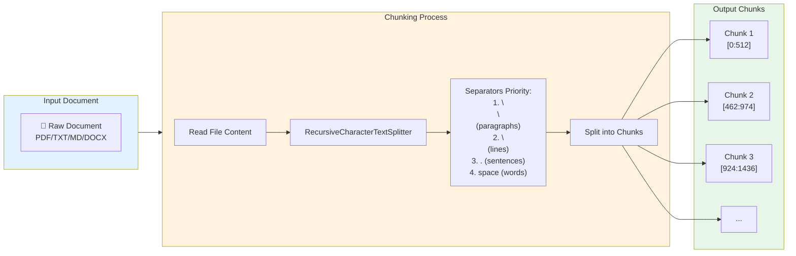
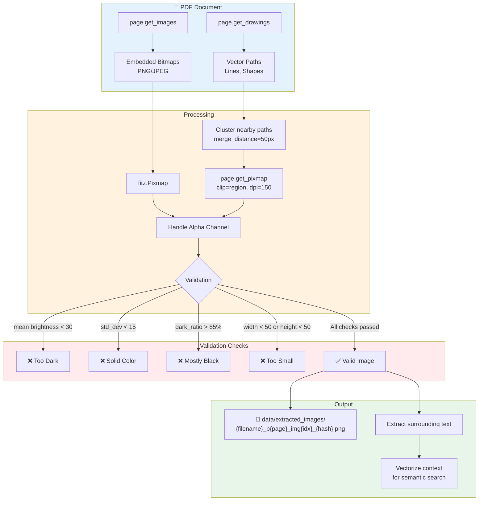
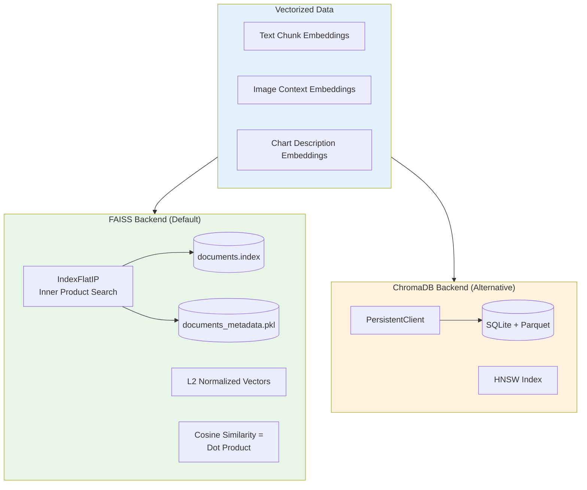

# Document Processing Workflow

## Command: `python -m src.main process`

Sơ đồ dưới đây mô tả chi tiết luồng xử lý khi chạy lệnh `process`.

---

## 1. Tổng quan Pipeline


---

## 2. Chi tiết Text Chunking



**Configuration:**
| Parameter | Value | Description |
|-----------|-------|-------------|
| `chunk_size` | 512 | Characters per chunk |
| `chunk_overlap` | 50 | Overlap between consecutive chunks |
| `separators` | `[\n\n, \n, . , , ]` | Priority order for splitting |

---

## 3. Chi tiết Image Extraction



---

## 4. Chi tiết Vectorization

```mermaid
flowchart LR
    subgraph INPUT["Input"]
        T1["Text Chunk<br/>'The authentication flow...'"]
        T2["Image Context<br/>'Figure 1: Login diagram...'"]
        T3["Chart Description<br/>'Sequence: User → Server'"]
    end

    subgraph MODEL["GTE Model"]
        M1["Alibaba-NLP/gte-multilingual-base"]
        M2["Max Sequence: 8192 tokens"]
        M3["Embedding Dimension: 768"]
    end

    subgraph PROCESS["Processing"]
        E1[SentenceTransformer.encode]
        E2[L2 Normalization]
    end

    subgraph OUTPUT["Output"]
        V1["[0.023, -0.156, 0.089, ..., 0.042]<br/>768-dimensional vector"]
    end

    INPUT --> MODEL
    MODEL --> PROCESS
    PROCESS --> OUTPUT

    style INPUT fill:#E3F2FD
    style MODEL fill:#FFF3E0
    style PROCESS fill:#F3E5F5
    style OUTPUT fill:#E8F5E9
```



---

## 5. Storage Architecture



---

## 6. Output Summary

Khi `process` hoàn thành, terminal sẽ hiển thị:

```
==================================================
Processing complete!
  Text chunks: 150
  Images extracted: 125
  Total items in database: 275
```

### File Outputs:

| Location | Content |
|----------|---------|
| `data/faiss_index/documents.index` | FAISS vector index |
| `data/faiss_index/documents_metadata.pkl` | Metadata + documents |
| `data/extracted_images/*.png` | Extracted images from PDFs |

---

## 7. Command Options

```bash
# Full processing (text + images + charts)
python -m src.main process

# Skip image extraction
python -m src.main process --no-images

# Skip Mermaid chart processing
python -m src.main process --no-charts

# Custom input directory
python -m src.main process --input /path/to/documents
```
