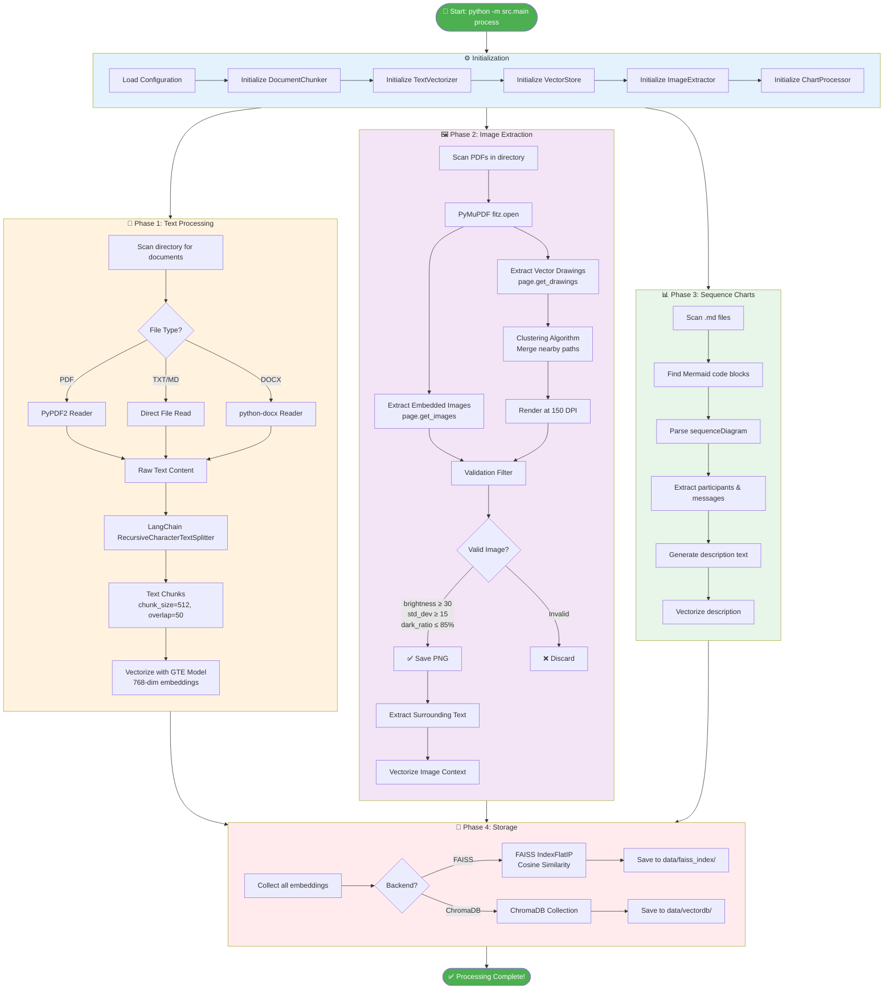
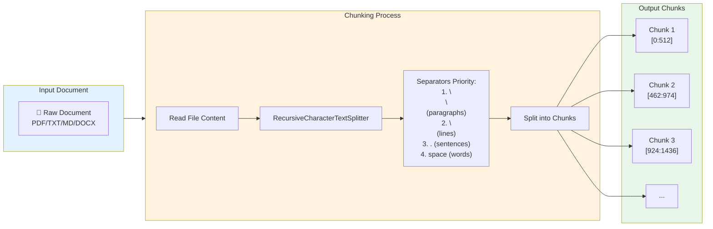
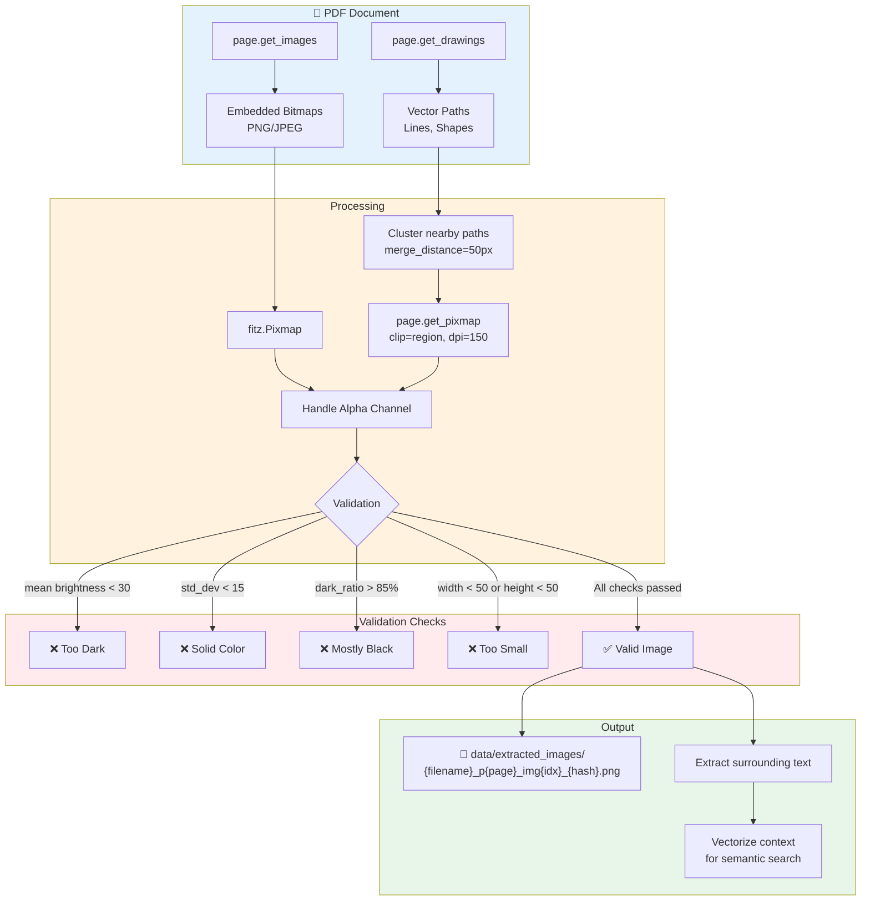
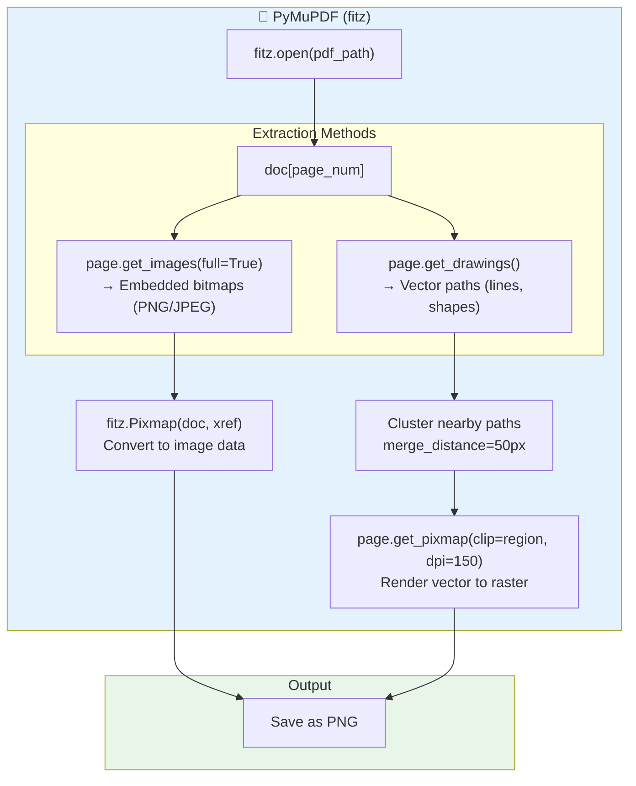
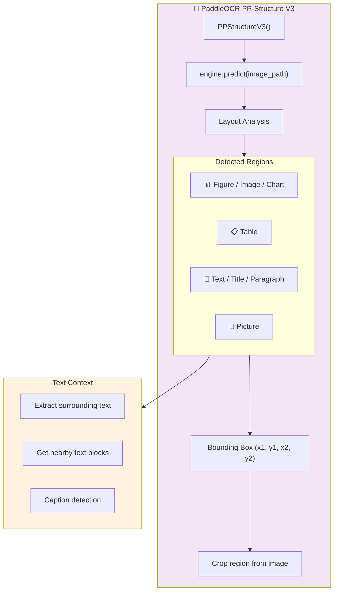
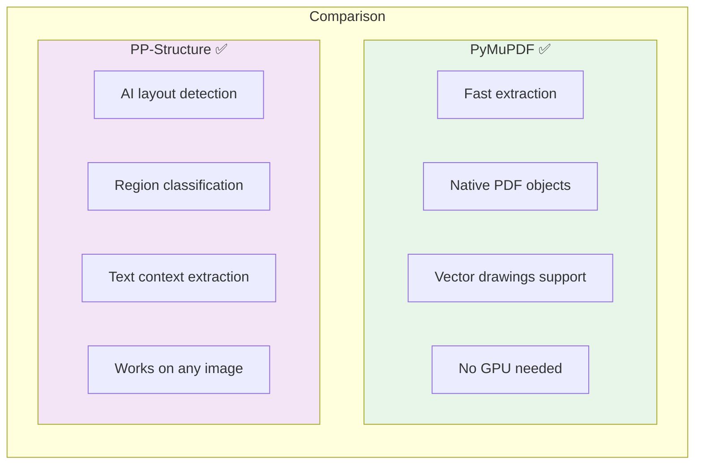
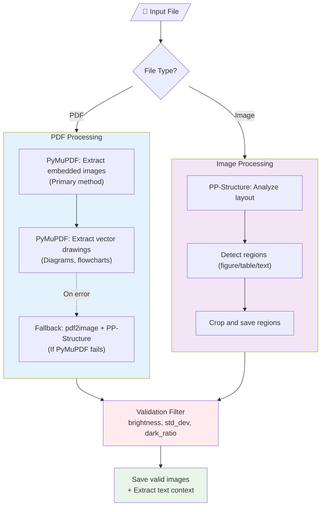
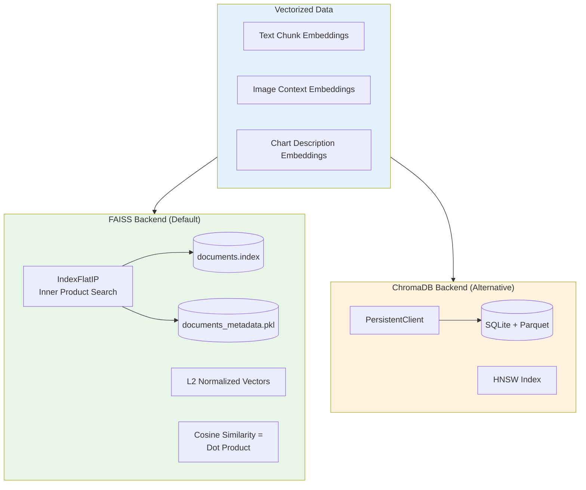

```mermaid
flowchart LR
    subgraph INPUT["Input"]
        T1["Text Chunk<br/>'The authentication flow...'"]
        T2["Image Context<br/>'Figure 1: Login diagram...'"]
        T3["Chart Description<br/>'Sequence: User → Server'"]
    end

    subgraph MODEL["GTE Model"]
        M1["Alibaba-NLP/gte-multilingual-base"]
        M2["Max Sequence: 8192 tokens"]
        M3["Embedding Dimension: 768"]
    end

    subgraph PROCESS["Processing"]
        E1[SentenceTransformer.encode]
        E2[L2 Normalization]
    end

    subgraph OUTPUT["Output"]
        V1["[0.023, -0.156, 0.089, ..., 0.042]<br/>768-dimensional vector"]
    end

    INPUT --> MODEL
    MODEL --> PROCESS
    PROCESS --> OUTPUT

    style INPUT fill:#E3F2FD
    style MODEL fill:#FFF3E0
    style PROCESS fill:#F3E5F5
    style OUTPUT fill:#E8F5E9
```

# Document Processing Workflow

## Command: `python -m src.main process`

Sơ đồ dưới đây mô tả chi tiết luồng xử lý khi chạy lệnh `process`.

---

## 1. Tổng quan Pipeline



---

## 2. Chi tiết Text Chunking



**Configuration:**
| Parameter | Value | Description |
|-----------|-------|-------------|
| `chunk_size` | 512 | Characters per chunk |
| `chunk_overlap` | 50 | Overlap between consecutive chunks |
| `separators` | `[\n\n, \n, . , , ]` | Priority order for splitting |

---

## 3. Chi tiết Image Extraction



---

## 4. Chi tiết PaddleOCR PP-Structure và PyMuPDF

### Tổng quan hai công nghệ

Dự án sử dụng **hai phương pháp** để trích xuất hình ảnh từ documents:

| Công nghệ | Vai trò | Khi nào sử dụng |
|-----------|---------|-----------------|
| **PyMuPDF (fitz)** | Phương pháp chính | Trích xuất trực tiếp từ PDF |
| **PaddleOCR PP-Structure** | Phương pháp bổ sung | Phân tích layout phức tạp, xử lý ảnh |

### 4.1 PyMuPDF (fitz) - Phương pháp chính



**Ưu điểm PyMuPDF:**
- ⚡ **Nhanh**: Trích xuất trực tiếp từ PDF, không cần render toàn trang
- 🎯 **Chính xác**: Lấy đúng embedded images gốc
- 📐 **Vector support**: Trích xuất cả vector drawings (diagrams, flowcharts)
- 💾 **Nhẹ**: Không cần GPU, chạy nhanh trên CPU

**Code flow trong `extractor.py`:**
```python
# Line 159-250: Trích xuất embedded images
def _extract_pdf_with_pymupdf(self, pdf_path: Path):
    doc = fitz.open(str(pdf_path))
    for page_num in range(len(doc)):
        page = doc[page_num]
        image_list = page.get_images(full=True)  # Lấy danh sách images
        for img in image_list:
            xref = img[0]
            pix = fitz.Pixmap(doc, xref)  # Chuyển thành Pixmap
            # Xử lý alpha channel, color space...
            pix.save(str(image_path))

# Line 252-357: Trích xuất vector drawings
def _extract_drawings_with_pymupdf(self, pdf_path: Path):
    drawings = page.get_drawings()  # Lấy vector paths
    # Cluster nearby rects để gom thành diagram
    for rect in clusters:
        pix = page.get_pixmap(clip=rect, dpi=150)  # Render vùng
```

---

### 4.2 PaddleOCR PP-Structure - Phân tích Layout



**Ưu điểm PaddleOCR PP-Structure:**
- 🧠 **AI-powered**: Deep learning model phát hiện layout chính xác
- 📊 **Multi-region**: Phân biệt được figure, table, text, chart
- 📖 **Context aware**: Lấy được text context xung quanh hình
- 🌐 **OCR tích hợp**: Có thể OCR text trong hình

**Khi nào PP-Structure được gọi (trong `extractor.py`):**
```python
# Line 112-128: Khởi tạo PP-Structure engine (lazy loading)
def _init_structure_engine(self):
    from paddleocr import PPStructureV3
    engine = PPStructureV3(
        use_doc_orientation_classify=False,  # Không cần xoay trang
        use_doc_unwarping=False,  # Không cần làm phẳng
    )
    return engine

# Line 396-486: Xử lý ảnh với PP-Structure
def _extract_from_image(self, image_path, source_file, page_number):
    results = self.structure_engine.predict(input=str(image_path))
    
    for result in results:
        layout_result = result.layout_parsing_result
        for box in layout_result.get('boxes', []):
            region_type = box.get('type')  # 'figure', 'table', etc.
            bbox = box.get('bbox')
            # Crop and save region...
```

---

### 4.3 So sánh hai phương pháp



| Tiêu chí | PyMuPDF | PP-Structure |
|----------|---------|--------------|
| **Tốc độ** | ⚡ Rất nhanh | 🐢 Chậm hơn (AI model) |
| **Độ chính xác** | Cao với PDF chuẩn | Cao với layout phức tạp |
| **GPU** | Không cần | Có thể dùng để tăng tốc |
| **Input** | Chỉ PDF | Mọi định dạng ảnh |
| **Output** | Raw images | Classified regions |

---

### 4.4 Luồng xử lý thực tế



---

### 4.5 Cấu hình Image Extraction

```python
@dataclass  
class ImageExtractionConfig:
    # Output settings
    output_dir: Path = EXTRACTED_IMAGES_DIR
    image_format: str = "png"
    
    # Size filters
    min_width: int = 50      # Bỏ qua ảnh < 50px
    min_height: int = 50
    
    # Quality filters (tránh black/empty images)
    min_brightness: float = 30.0     # Mean brightness >= 30
    min_std_dev: float = 15.0        # Variance >= 15
    max_dark_pixel_ratio: float = 0.85  # Dark pixels < 85%
    
    # Region types to extract
    extract_tables: bool = True
    extract_figures: bool = True
    
    # Context extraction
    context_chars: int = 500  # Lấy 500 chars xung quanh ảnh
    
    # Vector drawings clustering
    cluster_merge_distance: int = 50   # Merge paths within 50px
    min_diagram_size: int = 100        # Min diagram size
```

---

## 5. Chi tiết Vectorization



---

## 6. Storage Architecture



---

## 7. Output Summary

Khi `process` hoàn thành, terminal sẽ hiển thị:

```
==================================================
Processing complete!
  Text chunks: 150
  Images extracted: 125
  Total items in database: 275
```

### File Outputs:

| Location | Content |
|----------|---------|
| `data/faiss_index/documents.index` | FAISS vector index |
| `data/faiss_index/documents_metadata.pkl` | Metadata + documents |
| `data/extracted_images/*.png` | Extracted images from PDFs |

---

## 8. Command Options

```bash
# Full processing (text + images + charts)
python -m src.main process

# Skip image extraction
python -m src.main process --no-images

# Skip Mermaid chart processing
python -m src.main process --no-charts

# Custom input directory
python -m src.main process --input /path/to/documents
```
