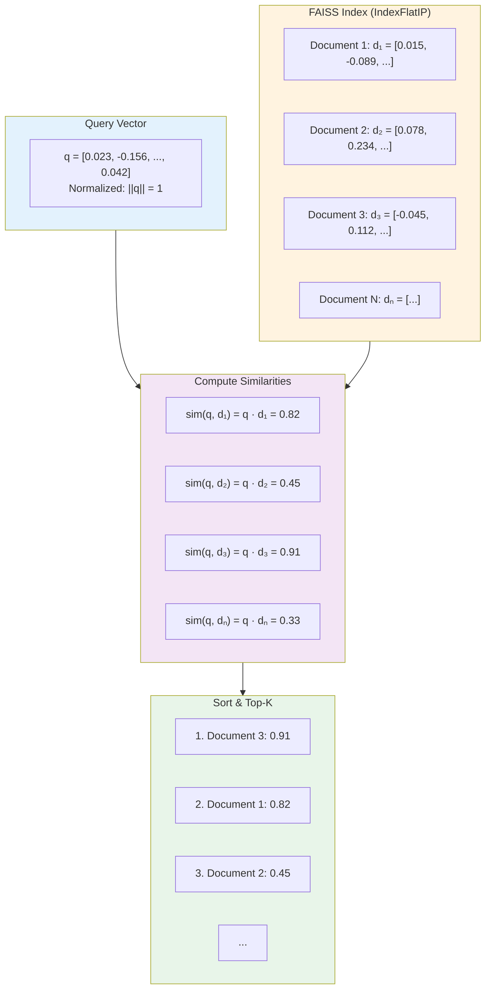
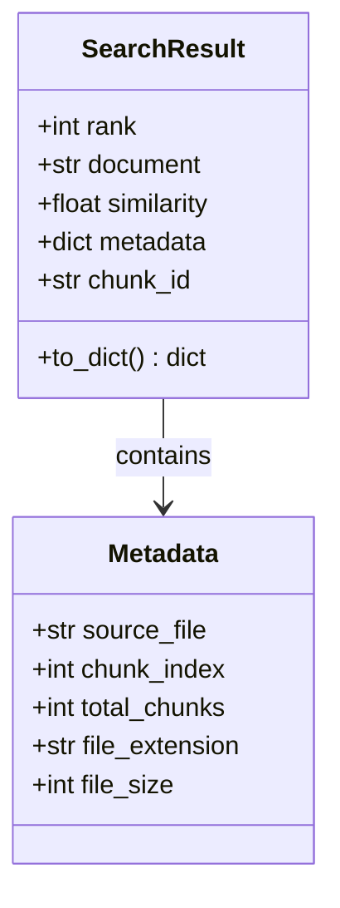
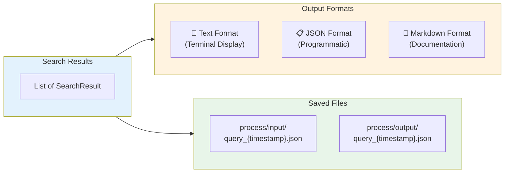
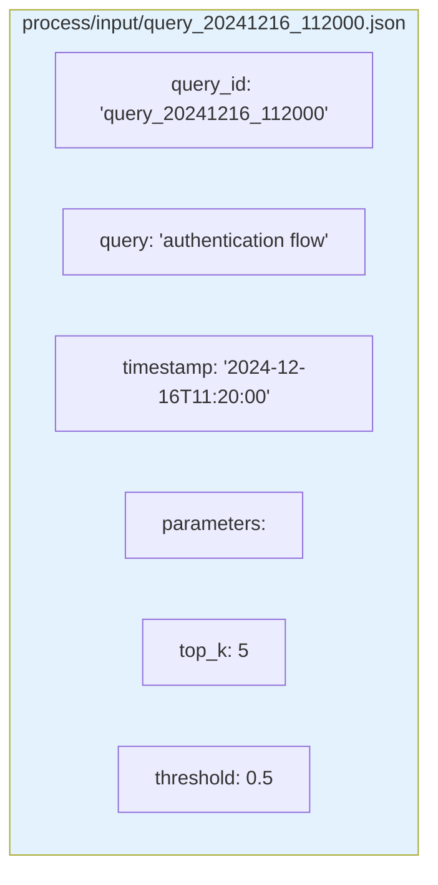
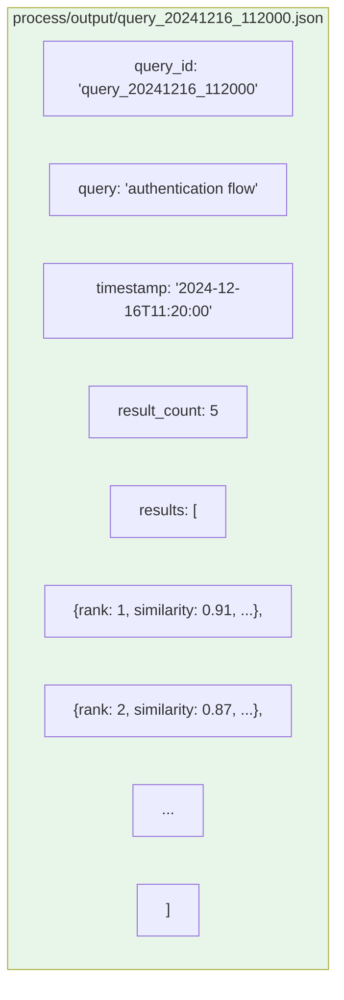

# Search Workflow

## Command: `python -m src.main search "<query>"`

Sơ đồ dưới đây mô tả chi tiết luồng tìm kiếm semantic trong hệ thống RAG.

---

## 1. Tổng quan Search Pipeline

```mermaid
flowchart TB
    START([🔍 Start: python -m src.main search "query"]) --> PARSE

    subgraph PARSE["📝 Parse Arguments"]
        P1[Extract query string]
        P2[Get top_k parameter<br/>default: 5]
        P3[Get save_results flag<br/>default: true]
    end

    PARSE --> INIT

    subgraph INIT["⚙️ Initialize Components"]
        I1[Load SearchEngine] --> I2[Load TextVectorizer]
        I2 --> I3[Load VectorStore<br/>FAISS or ChromaDB]
        I3 --> I4[Load GTE Model<br/>if not cached]
    end

    INIT --> VECTORIZE

    subgraph VECTORIZE["🧠 Query Vectorization"]
        V1["Input: 'authentication flow'"]
        V2[GTE Model Encode]
        V3[L2 Normalization]
        V4["Output: [0.023, -0.156, ..., 0.042]<br/>768-dim vector"]
        V1 --> V2 --> V3 --> V4
    end

    VECTORIZE --> SEARCH

    subgraph SEARCH["🔎 Similarity Search"]
        S1[Load FAISS Index<br/>or ChromaDB Collection]
        S2[Compute Cosine Similarity<br/>query · document vectors]
        S3[Sort by Score Descending]
        S4[Get Top-K Results]
        S1 --> S2 --> S3 --> S4
    end

    SEARCH --> FILTER

    subgraph FILTER["🎯 Filter & Rank"]
        F1{Score ≥ Threshold?}
        F1 -->|"score ≥ 0.5"| F2[✅ Include Result]
        F1 -->|"score < 0.5"| F3[❌ Exclude]
        F2 --> F4[Attach Metadata]
        F4 --> F5[Format Results]
    end

    FILTER --> OUTPUT

    subgraph OUTPUT["📤 Output"]
        O1[Display to Terminal]
        O2[Save to process/input/]
        O3[Save to process/output/]
    end

    OUTPUT --> END([✅ Search Complete!])

    style START fill:#2196F3,color:#fff
    style END fill:#4CAF50,color:#fff
    style PARSE fill:#E3F2FD
    style INIT fill:#FFF3E0
    style VECTORIZE fill:#F3E5F5
    style SEARCH fill:#E8F5E9
    style FILTER fill:#FFEBEE
    style OUTPUT fill:#E0F7FA
```

---

## 2. Chi tiết Query Vectorization

```mermaid
flowchart LR
    subgraph INPUT["User Query"]
        Q1["'authentication flow diagram'"]
    end

    subgraph TOKENIZE["Tokenization"]
        T1[BERT Tokenizer]
        T2["[CLS] authentication flow diagram [SEP]"]
        T3[Token IDs: [101, 8285, 2340, ...]]
    end

    subgraph ENCODE["Model Forward Pass"]
        E1[BERT Encoder<br/>12 layers]
        E2[Self-Attention]
        E3[Feed Forward]
        E4[Pooling Layer]
    end

    subgraph OUTPUT["Query Embedding"]
        O1["768-dim float vector"]
        O2[L2 Normalize]
        O3["||v|| = 1.0"]
    end

    INPUT --> TOKENIZE --> ENCODE --> OUTPUT

    style INPUT fill:#E3F2FD
    style TOKENIZE fill:#FFF3E0
    style ENCODE fill:#F3E5F5
    style OUTPUT fill:#E8F5E9
```

---

## 3. FAISS Similarity Search



### Cosine Similarity Formula:

```
                    q · d
similarity(q, d) = ─────────
                   ||q|| × ||d||

Với normalized vectors (||q|| = ||d|| = 1):
similarity(q, d) = q · d (inner product)
```

---

## 4. SearchResult Structure



### Example Result:

```json
{
    "rank": 1,
    "document": "The authentication flow begins when the user...",
    "similarity": 0.9123,
    "metadata": {
        "source_file": "auth_spec.pdf",
        "chunk_index": 5,
        "total_chunks": 42,
        "file_extension": ".pdf"
    },
    "chunk_id": "auth_spec.pdf_5"
}
```

---

## 5. Output Formats



### Terminal Output Example:

```
Searching for: 'authentication flow'
Using backend: faiss
--------------------------------------------------
Found 5 results:

[1] Score: 0.9123
    Source: data/documents/auth_spec.pdf
    Content: The authentication flow begins when the user submits credentials...

[2] Score: 0.8756
    Source: data/documents/security_guide.md
    Content: OAuth 2.0 authentication flow involves the following steps...

[3] Score: 0.8234
    Source: data/documents/api_docs.pdf
    Content: API authentication requires a valid JWT token...
```

---

## 6. Process/Input JSON Structure



---

## 7. Process/Output JSON Structure



---

## 8. Configuration

```python
# config/settings.py
class SearchConfig:
    top_k: int = 5              # Number of results to return
    score_threshold: float = 0.5 # Minimum similarity score
    include_metadata: bool = True # Include source info
```

---

## 9. Command Options

```bash
# Basic search
python -m src.main search "authentication flow"

# Get more results
python -m src.main search "user login" --top-k 10

# Don't save input/output files
python -m src.main search "API security" --no-save
```

---

## 10. Search Performance

| Dataset Size | Index Type | Search Time |
|--------------|------------|-------------|
| < 10,000 vectors | Flat | < 10ms |
| 10,000 - 100,000 | Flat | 10-50ms |
| > 100,000 | IVF/HNSW | 5-20ms |

**Note:** FAISS IndexFlatIP performs exhaustive search on all vectors. For larger datasets, consider switching to IVF or HNSW index types in `config/settings.py`.
