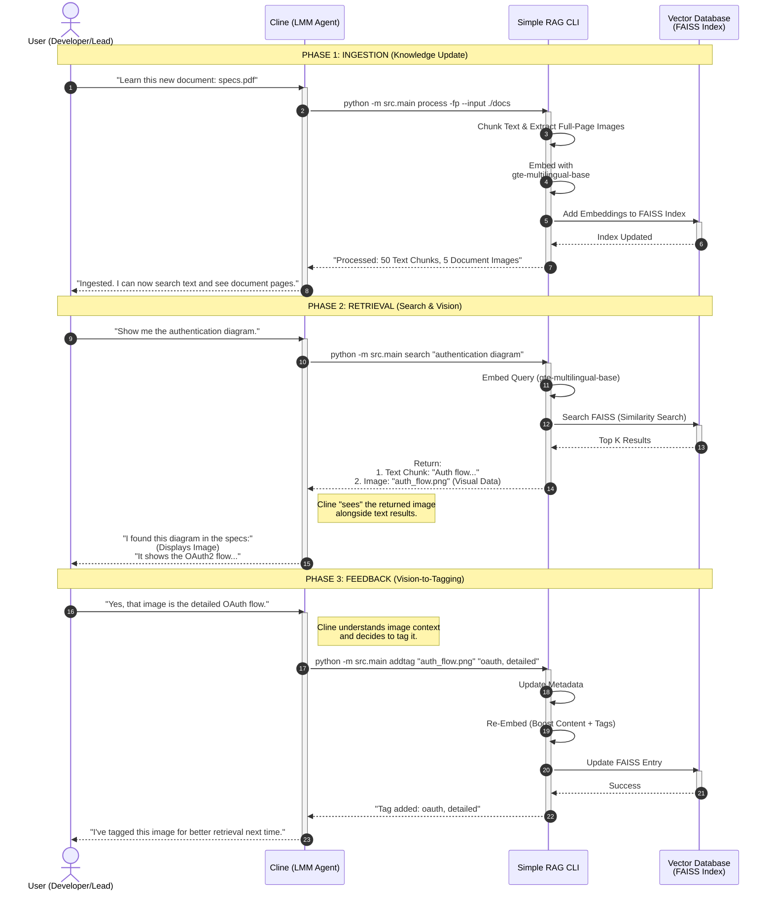
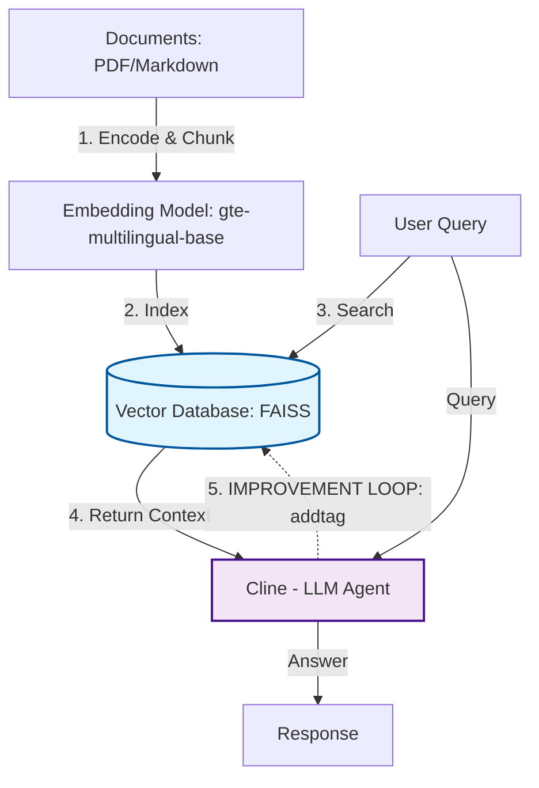

# 🔄 Luồng Xử Lý Chính (Process Flow)

## 1. Tổng Quan Luồng Process

Khi chạy lệnh `python -m src.main process -fp`, hệ thống thực hiện pipeline sau:

```
┌─────────────────────────────────────────────────────────────────────────────┐
│                        PROCESS DOCUMENTS PIPELINE                            │
├─────────────────────────────────────────────────────────────────────────────┤
│                                                                              │
│  ┌─────────────┐                                                             │
│  │ CLI Entry   │  python -m src.main process -fp                            │
│  │  main.py    │                                                             │
│  └──────┬──────┘                                                             │
│         │                                                                    │
│         ▼                                                                    │
│  ┌─────────────────────────────────────────────────────────────────────┐    │
│  │                    process_documents()                               │    │
│  │  ┌───────────────────────────────────────────────────────────────┐  │    │
│  │  │ Step 1: Initialize Components                                 │  │    │
│  │  │   - DocumentChunker()                                         │  │    │
│  │  │   - get_vectorizer()                                          │  │    │
│  │  │   - get_vector_store()                                        │  │    │
│  │  │   - get_chart_processor()                                     │  │    │
│  │  │   - get_image_extractor()                                     │  │    │
│  │  └───────────────────────────────────────────────────────────────┘  │    │
│  │                              │                                       │    │
│  │                              ▼                                       │    │
│  │  ┌───────────────────────────────────────────────────────────────┐  │    │
│  │  │ Step 2: Process Documents (Text Chunks)                       │  │    │
│  │  │   chunker.chunk_directory(input_dir)                          │  │    │
│  │  │   → Returns: List[DocumentChunk]                              │  │    │
│  │  └───────────────────────────────────────────────────────────────┘  │    │
│  │                              │                                       │    │
│  │                              ▼                                       │    │
│  │  ┌───────────────────────────────────────────────────────────────┐  │    │
│  │  │ Step 3: Extract Images from PDFs                              │  │    │
│  │  │   image_extractor.extract_from_file(pdf, fullpage_mode=True)  │  │    │
│  │  │   → Returns: List[ExtractedImage]                             │  │    │
│  │  └───────────────────────────────────────────────────────────────┘  │    │
│  │                              │                                       │    │
│  │                              ▼                                       │    │
│  │  ┌───────────────────────────────────────────────────────────────┐  │    │
│  │  │ Step 4: Process Sequence Charts                               │  │    │
│  │  │   chart_processor.process_file(md_file)                       │  │    │
│  │  │   → Returns: List[SequenceChart]                              │  │    │
│  │  └───────────────────────────────────────────────────────────────┘  │    │
│  │                              │                                       │    │
│  │                              ▼                                       │    │
│  │  ┌───────────────────────────────────────────────────────────────┐  │    │
│  │  │ Step 5: Batch Vectorization                                   │  │    │
│  │  │   vectorizer.vectorize(texts)                                 │  │    │
│  │  │   → Returns: np.ndarray (N x 768)                             │  │    │
│  │  └───────────────────────────────────────────────────────────────┘  │    │
│  │                              │                                       │    │
│  │                              ▼                                       │    │
│  │  ┌───────────────────────────────────────────────────────────────┐  │    │
│  │  │ Step 6: Store in Vector DB                                    │  │    │
│  │  │   vector_store.add_chunks(items_to_vectorize)                 │  │    │
│  │  │   → Persists to data/faiss_index/                             │  │    │
│  │  └───────────────────────────────────────────────────────────────┘  │    │
│  └─────────────────────────────────────────────────────────────────────┘    │
│                                                                              │
└─────────────────────────────────────────────────────────────────────────────┘
```

## 2. Chi Tiết Từng Bước

### Step 1: Initialize Components

```python
# File: src/main.py - process_documents()

def process_documents(input_dir, include_charts, include_images, fullpage_mode):
    # 1. Initialize all components
    chunker = DocumentChunker()           # Text splitting
    vectorizer = get_vectorizer()         # Embedding model
    vector_store = get_vector_store()     # FAISS/ChromaDB
    chart_processor = get_chart_processor()  # Mermaid parser
    image_extractor = get_image_extractor()  # Image extraction
    
    # Prepare batch collector
    items_to_vectorize = []
```

**Luồng khởi tạo:**

```
DocumentChunker()
    └── Load config from settings.chunking
    └── Create RecursiveCharacterTextSplitter
    
get_vectorizer()
    └── TextVectorizer()
        └── Lazy load SentenceTransformer model
        
get_vector_store()
    └── Check settings.vectordb.backend
        ├── "faiss" → FaissVectorStore()
        └── "chromadb" → VectorStore()
    └── Load existing index if available
```

### Step 2: Process Documents (Text Chunks)

```python
# File: src/main.py
print("\n[1/3] Processing documents...")
chunks = chunker.chunk_directory(input_dir)
```

**Chi tiết chunking flow:**

```
chunk_directory(input_dir)
    │
    ├── Scan: data/documents/**/*
    │   ├── *.txt, *.md, *.markdown → read_text()
    │   ├── *.pdf → _read_pdf() via PyMuPDF
    │   └── *.docx → _read_docx() via python-docx
    │
    └── For each file:
        │
        ├── chunk_file(file_path)
        │   ├── Read content based on extension
        │   └── chunk_text(content, source_file, metadata)
        │       │
        │       └── RecursiveCharacterTextSplitter.split_text()
        │           │
        │           └── Returns: List[str] chunks
        │
        └── Create DocumentChunk objects:
            {
              chunk_id: "{filename}_{index}",
              content: "chunk text...",
              metadata: {chunk_index, total_chunks, file_name, file_size},
              start_index: 0,
              end_index: 512,
              source_file: "path/to/file.pdf"
            }
```

**Output của Step 2:**
```python
chunks = [
    DocumentChunk(chunk_id="HID.pdf_0", content="...", ...),
    DocumentChunk(chunk_id="HID.pdf_1", content="...", ...),
    ...
]
```

### Step 3: Extract Images from PDFs

```python
# File: src/main.py
if include_images:
    print("\n[2/3] Extracting images from PDFs...")
    for pdf_file in input_dir.glob("**/*.pdf"):
        extracted = image_extractor.extract_from_file(
            pdf_file, 
            fullpage_mode=fullpage_mode
        )
```

**Chi tiết extraction flow (xem 05-flow-image-extraction.md):**

```
extract_from_file(pdf_path, fullpage_mode=True)
    │
    ├── fullpage_mode=True:
    │   └── _extract_fullpage_from_pdf(pdf_path)
    │       ├── For each page:
    │       │   ├── Check has images/drawings
    │       │   ├── Render full page at 150 DPI
    │       │   ├── Extract page text
    │       │   └── Auto-generate tags (regex)
    │       └── Return: List[ExtractedImage]
    │
    └── fullpage_mode=False:
        └── extract_from_pdf(pdf_path)
            ├── _extract_pdf_with_pymupdf()
            ├── _extract_drawings_with_pymupdf()
            └── _analyze_pdf_layout_with_ppstructure() (optional)
```

**Output của Step 3:**
```python
extracted = [
    ExtractedImage(
        image_id="HID.pdf_p30",
        image_path="data/extracted_images/HID.pdf_p30.png",
        page_number=30,
        surrounding_text="...",
        tags="Figure 4.1: Media payload format"
    ),
    ...
]
```

### Step 4: Process Sequence Charts

```python
# File: src/main.py
if include_charts:
    print("\n[3/3] Processing sequence charts...")
    for md_file in input_dir.glob("**/*.md"):
        charts = chart_processor.process_file(md_file, export_images=True)
```

**Chi tiết chart flow:**

```
process_file(md_file)
    │
    ├── Read markdown content
    │
    ├── extract_from_markdown(content)
    │   ├── Regex: ```mermaid\n(.*?)\n```
    │   └── For each match containing 'sequenceDiagram':
    │       └── parse_mermaid(content)
    │           ├── Parse title
    │           ├── Parse participants
    │           ├── Parse messages (->> arrows)
    │           ├── Parse notes
    │           └── Generate description
    │
    └── export_image(chart) if export_images=True
        ├── Try mmdc (mermaid-cli)
        └── Fallback: create placeholder with PIL
```

**Output của Step 4:**
```python
charts = [
    SequenceChart(
        chart_id="abc123",
        title="Authentication Flow",
        participants=["Client", "Server", "DB"],
        description="Sequence Diagram: Authentication Flow\n..."
    ),
    ...
]
```

### Step 5: Batch Vectorization

```python
# File: src/main.py

# Collect all items
items_to_vectorize = []

# Add text chunks
for chunk in chunks:
    items_to_vectorize.append({
        "chunk_id": chunk.chunk_id,
        "content": chunk.content,
        "metadata": chunk.metadata,
        "source_file": chunk.source_file,
        "type": "text"
    })

# Add images
image_data = image_extractor.get_vectorization_data(extracted)
items_to_vectorize.extend(image_data)

# Add charts
chart_data = chart_processor.get_vectorization_data(charts)
items_to_vectorize.extend(chart_data)

# BATCH VECTORIZE
print(f"\n[4/4] Vectorizing {len(items_to_vectorize)} items...")
texts = [item["content"] for item in items_to_vectorize]
embeddings = vectorizer.vectorize(texts)
```

**Chi tiết vectorization flow:**

```
vectorizer.vectorize(texts)
    │
    ├── Load model (lazy, first call only)
    │   └── SentenceTransformer(
    │         "models/gte-multilingual-base",
    │         trust_remote_code=True,
    │         device="cpu"
    │       )
    │
    └── model.encode(
          texts,
          batch_size=32,
          normalize_embeddings=True,
          convert_to_numpy=True
        )
        │
        └── Returns: np.ndarray shape (N, 768)
```

**Thư viện sử dụng:**
- `sentence-transformers` → Load và encode
- `transformers` → Tokenization
- `torch` → Backend computation
- `numpy` → Output array

### Step 6: Store in Vector DB

```python
# File: src/main.py

# Attach embeddings to items
for item, embedding in zip(items_to_vectorize, embeddings):
    item["embedding"] = embedding.tolist()
    item["metadata"]["content_type"] = item["type"]

# Store
vector_store.add_chunks(items_to_vectorize)
```

**Chi tiết storage flow (FAISS):**

```
FaissVectorStore.add_chunks(vectorized_chunks)
    │
    ├── Extract: ids, embeddings, documents, metadatas
    │
    ├── add(ids, embeddings, documents, metadatas)
    │   │
    │   ├── Update in-memory storage:
    │   │   self._embeddings[doc_id] = embedding
    │   │   self._documents[doc_id] = content
    │   │   self._metadata[doc_id] = metadata
    │   │
    │   ├── _rebuild_index()
    │   │   ├── Convert embeddings to numpy matrix
    │   │   ├── faiss.normalize_L2(matrix)
    │   │   ├── Create fresh IndexFlatIP
    │   │   └── index.add(matrix)
    │   │
    │   └── _save()
    │       ├── faiss.write_index() → documents.index
    │       └── pickle.dump() → documents_metadata.pkl
    │           {
    │             'metadata': {...},
    │             'documents': {...},
    │             'embeddings': {...},
    │             'dimension': 768
    │           }
```

## 3. Sequence Diagram Tổng Quan

```
┌──────┐    ┌─────────┐    ┌────────────┐    ┌───────────┐    ┌────────────┐
│ CLI  │    │ Chunker │    │ Extractor  │    │ Vectorizer│    │VectorStore │
└──┬───┘    └────┬────┘    └─────┬──────┘    └─────┬─────┘    └─────┬──────┘
   │             │               │                 │                │
   │ process()   │               │                 │                │
   │─────────────│               │                 │                │
   │             │               │                 │                │
   │ chunk_dir() │               │                 │                │
   │────────────>│               │                 │                │
   │             │               │                 │                │
   │  chunks[]   │               │                 │                │
   │<────────────│               │                 │                │
   │             │               │                 │                │
   │ extract()   │               │                 │                │
   │─────────────│──────────────>│                 │                │
   │             │               │                 │                │
   │  images[]   │               │                 │                │
   │<────────────│───────────────│                 │                │
   │             │               │                 │                │
   │ vectorize(all_texts)        │                 │                │
   │─────────────│───────────────│────────────────>│                │
   │             │               │                 │                │
   │  embeddings[]               │                 │                │
   │<────────────│───────────────│─────────────────│                │
   │             │               │                 │                │
   │ add_chunks()│               │                 │                │
   │─────────────│───────────────│─────────────────│───────────────>│
   │             │               │                 │                │
   │             │               │                 │    rebuild()   │
   │             │               │                 │    save()      │
   │             │               │                 │                │
   │   "Done!"   │               │                 │                │
   │<────────────│───────────────│─────────────────│────────────────│
   │             │               │                 │                │
```

## 4. Data Transformation

```
Input Documents               After Chunking              After Vectorization
┌─────────────────┐          ┌────────────────┐          ┌────────────────────┐
│ HID.pdf         │    →     │ chunks = [     │    →     │ items = [          │
│ - 100 pages     │          │   {id: "0",    │          │   {                │
│ - 50MB          │          │    content: ..}│          │     id: "0",       │
└─────────────────┘          │   {id: "1"...} │          │     content: ...,  │
                             │   ...200 total │          │     embedding: [   │
                             │ ]              │          │       0.012, ...   │
                             └────────────────┘          │       768 dims     │
                                                         │     ]              │
                                                         │   },              │
                                                         │   ...              │
                                                         │ ]                  │
                                                         └────────────────────┘
                                                                  │
                                                                  ▼
                                                         ┌────────────────────┐
                                                         │ FAISS Index        │
                                                         │ - documents.index  │
                                                         │ - metadata.pkl     │
                                                         └────────────────────┘
```

## 5. Hybrid Mode Explanation

Hệ thống xử lý **song song** 2 loại nội dung:

```
                          ┌─────────────────┐
                          │     PDF File    │
                          └────────┬────────┘
                                   │
                     ┌─────────────┴─────────────┐
                     │                           │
                     ▼                           ▼
           ┌─────────────────┐         ┌─────────────────┐
           │   Text Layer    │         │   Image Layer   │
           │   (Chunking)    │         │  (Full-page)    │
           └────────┬────────┘         └────────┬────────┘
                    │                           │
                    ▼                           ▼
           ┌─────────────────┐         ┌─────────────────┐
           │ Granular search │         │ Visual context  │
           │ "find sentence" │         │ "find Figure 4" │
           └────────┬────────┘         └────────┬────────┘
                    │                           │
                    └─────────────┬─────────────┘
                                  │
                                  ▼
                         ┌─────────────────┐
                         │  Vector Index   │
                         │  (FAISS)        │
                         └─────────────────┘
```

**Lợi ích:**
- Text chunks: Tìm câu/đoạn cụ thể
- Full-page images: Tìm hình/diagram với context đầy đủ

## 6. Sơ Đồ Tích Hợp Hệ Thống (Cline + Simple RAG)

Đây là quy trình tương tác chi tiết giữa **User**, **Cline (AI Agent)** và **Simple RAG System** trong môi trường dự án thực tế.



### Giải thích các vai trò:

1.  **User**: Đưa ra yêu cầu bằng ngôn ngữ tự nhiên.
2.  **Cline (LLM Agent)**:
    *   Đóng vai trò "Bộ não" điều phối.
    *   Hiểu ý định người dùng (Intent Recognition).
    *   Quyết định gọi lệnh CLI nào của Simple RAG (`process`, `search`, hay `addtag`).
    *   Tổng hợp thông tin từ kết quả thô của CLI để trả lời người dùng mượt mà.
3.  **Simple RAG CLI**:
    *   Công cụ "Cánh tay phải" thực thi kỹ thuật.
    *   Chịu trách nhiệm xử lý dữ liệu nặng (PDF parsing, OCR).
    *   Tính toán vector và truy xuất dữ liệu chính xác.
4.  **Vector Database**: Kho lưu trữ kiến thức dài hạn của dự án.

## 7. Kiến Trúc Kết Nối Module (High-Level Data Flow)

Sơ đồ dưới đây mô tả mối quan hệ giữa các thành phần, đặc biệt nhấn mạnh vào **Feedback Loop** - cơ chế giúp Cline tự củng cố cơ sở dữ liệu.



### Điểm nổi bật

- **Vòng lặp số 5 (Improvement Loop)**: Đây là điểm khác biệt chính. Cline không chỉ "đọc" dữ liệu mà còn có quyền **"ghi chú"** lại vào Database thông qua lệnh `addtag`.
- Điều này giúp hệ thống RAG không còn là luồng một chiều (Static) mà trở nên **Dynamic**, "thông minh" hơn theo thời gian sử dụng.
