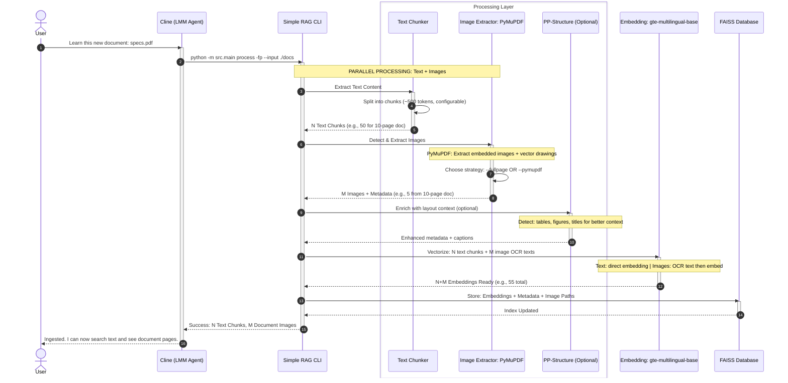
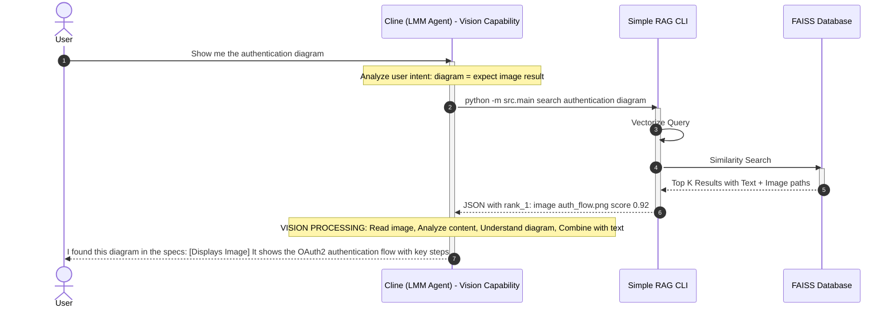
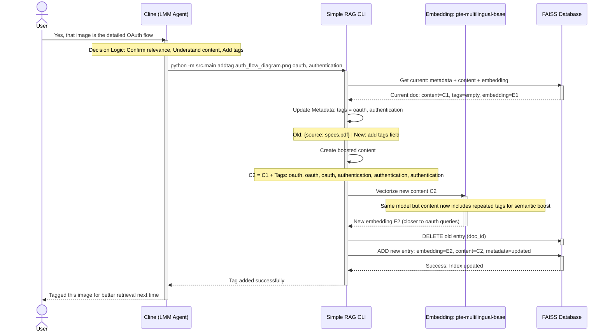
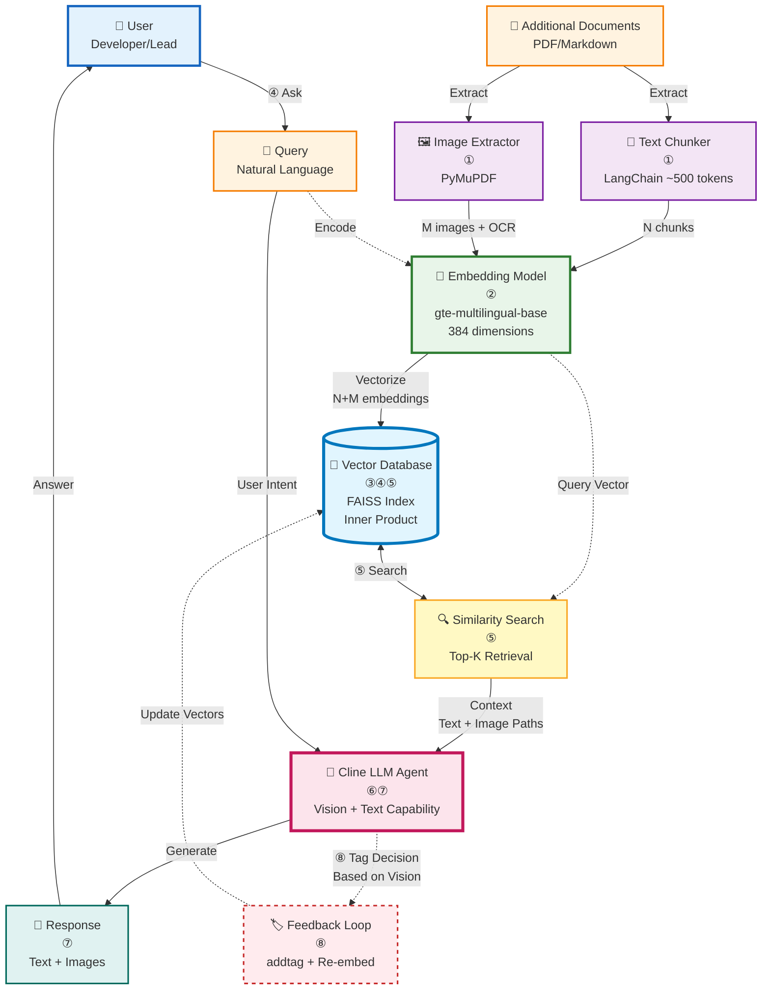

# Tích Hợp Cline + Simple RAG System

> **Mục đích**: Tài liệu này mô tả cách tích hợp giữa Cline (LLM Agent) và Simple RAG CLI, đặc biệt nhấn mạnh khả năng **Vision** của Cline trong việc xử lý kết quả tìm kiếm có chứa hình ảnh.

## 1. Tổng quan Kiến trúc

Simple RAG không chỉ là một công cụ tìm kiếm văn bản thông thường - nó được thiết kế để tích hợp sâu với các LLM Agent có khả năng multimodal (xử lý cả văn bản và hình ảnh). Cline, với khả năng vision, có thể:

- **Đọc kết quả văn bản** từ Simple RAG
- **"Nhìn" và phân tích hình ảnh** được trả về từ search results
- **Hiểu context** từ cả hai nguồn thông tin để đưa ra câu trả lời chính xác
- **Tự động gắn tag** cho hình ảnh sau khi "hiểu" nội dung, giúp cải thiện độ chính xác tìm kiếm trong tương lai

## 2. Quy Trình Tương Tác Chi Tiết (3 Phases)

### Phase 1: INGESTION - Cập nhật kiến thức

**Mục đích**: Nạp tài liệu mới vào hệ thống để Cline có thể tra cứu sau này.



**Chi tiết kỹ thuật xử lý**:

#### 1. Text Processing (Chunking)
- **Input**: PDF text content, Markdown files
- **Tool**: LangChain RecursiveCharacterTextSplitter
- **Logic**: 
  - Split by paragraphs, sentences
  - Chunk size: **~500 tokens (configurable)** - phụ thuộc use case
  - Overlap: **50 tokens (default)** - để giữ context liên tục
- **Output**: **N text chunks** (số lượng phụ thuộc vào document size) với metadata (source, page number)

> **Note**: Với document 10 trang thông thường → ~30-50 chunks. Document 100 trang → ~300-500 chunks.

#### 2. Image Processing (Extraction & Detection)

- **Input**: PDF pages
- **Primary Tool**: **PyMuPDF (fitz)** - Fast extraction engine
- **Optional Tool**: **PP-Structure (PaddleOCR)** - Layout analysis for context enrichment

**Extraction Strategies** (chọn 1 trong 2):

##### Strategy 1: Full-Page Mode (`--fullpage` / `-fp`)

```bash
python -m src.main process -fp --input ./docs
```

- **Logic**:
  - Render toàn bộ trang PDF thành ảnh (DPI 150)
  - Chỉ capture trang có chứa hình ảnh hoặc drawings
  - Giữ nguyên context đầy đủ của trang
- **Phù hợp cho**: Architecture diagrams, flowcharts, complex layouts
- **Output**: Ảnh full-page + toàn bộ text trong trang làm context

##### Strategy 2: Individual Image Mode (`--pymupdf` / `-pymu`)

```bash
python -m src.main process -pymu --input ./docs
```

- **Logic**:
  1. Extract embedded bitmaps từ PDF
  2. Extract vector drawings (diagrams rendered from paths)
  3. Filter: remove quá nhỏ, quá tối, hoặc empty images
  4. Find caption gần image (search trong 100px radius)
- **Phù hợp cho**: Product images, charts, screenshots
- **Output**: Individual image files + caption + surrounding text

**PP-Structure Enrichment** (tự động chạy nếu có images):

```python
# PP-Structure adds context to extracted images
if use_ppstructure and extracted_images:
    layout_info = analyze_layout_with_ppstructure(pdf_path)
    # Detects: text regions, figure regions, table regions, titles
    enriched_images = add_layout_context(images, layout_info)
```

**Detection & Validation**:

- **Size filter**: width ≥ 50px, height ≥ 50px
- **Content filter**: 
  - Brightness ≥ 30.0
  - Std deviation ≥ 15.0 (tránh blank images)
  - Dark pixel ratio ≤ 85% (tránh all-black images)
- **Caption detection**: Regex patterns for "Figure X.Y", "Table X", "Hình X", etc.

#### 3. Embedding Strategy
- **Text chunks**: Direct embedding với `gte-multilingual-base`
- **Images**: 
  1. OCR để extract text trong ảnh
  2. Embed OCR text (không embed pixel data)
  3. Store image path trong metadata
- **Kết quả**: Cả text và image đều có embedding vector trong FAISS

**Đặc điểm kỹ thuật**:

- **Embedding Model**: `gte-multilingual-base` (384 dimensions)
- **Vector Database**: FAISS Index (IndexFlatIP - Inner Product)
- **Image Extraction**: PP-Structure với full-page mode (`-fp`)

### Phase 2: RETRIEVAL - Tìm kiếm & Vision Processing

**Đây là phase quan trọng nhất** vì thể hiện khả năng multimodal của Cline.



**Chi tiết về Vision Processing**:

1. **Input từ Simple RAG**: Cline nhận được không chỉ metadata mà cả đường dẫn đến file ảnh thực tế
2. **Vision Analysis**: Cline sử dụng model multimodal để "xem" và phân tích nội dung hình ảnh
3. **Context Integration**: Kết hợp thông tin từ ảnh + text để tạo câu trả lời mạch lạc
4. **User Experience**: User thấy được cả ảnh gốc + phân tích chi tiết từ Cline

**Ví dụ thực tế**:

```json
// Simple RAG Search Output
{
  "results": [
    {
      "id": "doc_auth_page_05",
      "type": "image",
      "path": "/knowledge/docs/images/auth_flow_diagram.png",
      "metadata": {
        "source": "specs.pdf",
        "page": 5,
        "extraction_method": "fullpage"
      },
      "score": 0.92
    },
    {
      "id": "chunk_auth_text_001",
      "type": "text",
      "content": "The authentication system uses OAuth2 protocol for secure token-based access...",
      "score": 0.85
    }
  ]
}
```

```python
# Cline's Internal Processing (Pseudo-code)
def process_search_results(results):
    text_contexts = []
    image_contexts = []
    
    for result in results:
        if result['type'] == 'text':
            text_contexts.append(result['content'])
        elif result['type'] == 'image':
            # 🧠 VISION CAPABILITY
            image_path = result['path']
            image_analysis = vision_model.analyze(image_path)
            """
            image_analysis = {
                'detected_elements': ['flowchart', 'arrows', 'boxes'],
                'text_in_image': ['Login', 'OAuth Provider', 'Token'],
                'diagram_type': 'sequence_diagram',
                'main_flow': 'user_authentication_process'
            }
            """
            image_contexts.append(image_analysis)
    
    # Combine all contexts for response generation
    combined_context = {
        'text': text_contexts,
        'visual': image_contexts
    }
    
    return generate_answer(user_query, combined_context)
```

### Phase 3: FEEDBACK - Vision-to-Tagging với Re-Embedding

Sau khi Cline "hiểu" được nội dung hình ảnh, nó có thể **chủ động gắn tag** để cải thiện database.



**Chi tiết kỹ thuật về Re-Embedding**:

#### Tag Boosting Strategy

```python
# Before: Original content
original_content = "Image showing authentication flow between client and server..."

# After: Boosted content for embedding
tag = "oauth, authentication"
tag_boost = f"\nTags: {tag}, {tag}, {tag}"  # Repeat 3x
new_content = original_content + tag_boost

# Result:
# "Image showing authentication flow between client and server...
#  Tags: oauth, authentication, oauth, authentication, oauth, authentication"
```

**Tại sao lặp lại 3 lần?**
- 🎯 **Semantic Weight**: Embedding model sẽ "chú ý" nhiều hơn đến từ khóa xuất hiện nhiều lần
- 🔍 **Search Boost**: Khi user search "oauth", embedding của document này sẽ có cosine similarity cao hơn
- ⚖️ **Balance**: 3 lần là đủ để boost mà không làm overwhelm context gốc

#### Re-Embedding Process (5 Steps)

1. **Retrieve Current Data**
   ```python
   current_metadata = vector_store.get_metadata(doc_id)
   current_content = vector_store.get_content(doc_id)
   # Current embedding E1 is already in FAISS
   ```

2. **Update Metadata**
   ```python
   current_tags = current_metadata.get("tags", "")
   new_tags = f"{current_tags},{tag}" if current_tags else tag
   updated_metadata = {**current_metadata, "tags": new_tags}
   ```

3. **Create Boosted Content**
   ```python
   tag_boost = f"\nTags: {tag}, {tag}, {tag}"
   new_content = current_content + tag_boost
   ```

4. **Generate New Embedding**
   ```python
   from src.vectorization.vectorizer import vectorize_text
   new_embedding = vectorize_text(new_content)[0]  # Shape: (384,) for gte-multilingual-base
   
   # Embedding difference visualization:
   # E1 (before): [0.12, 0.45, -0.23, ...]  # Without tag semantic
   # E2 (after):  [0.18, 0.52, -0.19, ...]  # With tag semantic boost
   # Cosine(E2, "oauth") > Cosine(E1, "oauth")
   ```

5. **Atomic Update (Delete + Add)**
   ```python
   # Delete old entry to avoid duplicates
   vector_store.delete([doc_id])
   
   # Add new entry with updated embedding
   vector_store.add(
       ids=[doc_id],
       embeddings=[new_embedding],
       documents=[new_content],
       metadatas=[updated_metadata]
   )
   # FAISS index is automatically rebuilt with new embedding
   ```

**Ví dụ so sánh**:

| Stage | Content Sample | Tags | Embedding Vector | Similarity to "oauth" query |
|-------|---------------|------|------------------|----------------------------|
| **Before** | "Auth flow diagram..." | (empty) | E1: [0.12, 0.45, ...] | Score: 0.65 |
| **After** | "Auth flow diagram...<br/>Tags: oauth, oauth, oauth,<br/>authentication, authentication,<br/>authentication" | "oauth, authentication" | E2: [0.18, 0.52, ...] | Score: **0.89** ↑ |

**Lợi ích của Feedback Loop**:

- **Self-Improving Database**: Càng sử dụng, database càng chính xác
- **Semantic Enrichment**: Tags được gắn dựa trên "hiểu biết" thực sự của LLM, không chỉ keyword matching
- **Better Future Searches**: Lần tìm sau với từ khóa tương tự sẽ có độ chính xác cao hơn
- **No Model Retraining**: Chỉ cần re-embed, không cần train lại embedding model

## 3. Kiến Trúc Kết Nối Module

Sơ đồ dưới đây mô tả **toàn bộ hệ thống** với các bước chi tiết:



### Chi tiết từng bước (Complete Flow)

#### 🔵 **INGESTION PIPELINE** (Nạp dữ liệu - Steps ①②③)

```
📄 Documents
    ↓ ①
┌───────────────────┬────────────────────┐
│                   │                    │
🔪 Text Chunker    🖼️ Image Extractor
~500 tokens         PyMuPDF
    │                   │
    │ ② N chunks        │ ② M images + OCR
    │                   ↓
    │              🤖 PP-Structure
    │              (Layout Context)
    │                   │
    └─────────┬─────────┘
              ↓ ② All Content
        🧠 Embedding Model
        gte-multilingual-base
              │
              │ ③ Vectorize
              ↓
        💾 FAISS Database
        (N+M vectors stored)
```

**Kết quả**: Vector database chứa embeddings cho text chunks và images

#### 🟢 **QUERY PIPELINE** (Tìm kiếm - Steps ④⑤⑥⑦)

```
👤 User
    │ ④ "Show me OAuth diagram"
    ↓
🌟 Cline (LLM Agent)
    │ ⑤ Call CLI
    ↓
⚙️ Simple RAG CLI
    │ ⑥ Similarity Search
    ↓
💾 FAISS Database
    │ ⑥ Top-K Results
    │ (Text chunks + Image paths)
    ↓
⚙️ CLI → 🌟 Cline
           │
           │ ⑦ Vision Processing:
           │ - Read image files
           │ - Analyze visual content
           │ - Combine with text context
           ↓
       💬 Response
           │
           ↓
       👤 User receives answer
```

**Kết quả**: User nhận được câu trả lời với text + hình ảnh minh họa

#### 🟡 **FEEDBACK LOOP** (Cải thiện - Step ⑧)

```
🌟 Cline (After Vision Analysis)
    │
    │ Decision: Image relevant,
    │           should improve searchability
    │
    │ ⑧ Call: addtag "doc_id" "oauth, sequence-diagram"
    ↓
🏷️ addtag CLI
    │
    │ Process:
    │ 1. Retrieve current content
    │ 2. Boost: content + "Tags: oauth, oauth, oauth, ..."
    │ 3. Re-embed with gte-multilingual-base
    │ 4. DELETE old entry
    │ 5. ADD new entry
    │
    ↓
💾 FAISS Database UPDATED
    │
    │ Next search for "oauth" will
    │ rank this document higher!
    └─→ Improved searchability ✨
```

**Kết quả**: Database tự động cải thiện cho lần search sau

### Tổng quan Data Flow (8 Steps)

| Step | Component | Action | Input | Output |
|------|-----------|--------|-------|--------|
| **①** | Chunker & ImgExt | Extract content | PDF/MD files | N text chunks + M images |
| **②** | Embedding Model | Prepare data | Text + Images (OCR) | Ready for vectorization |
| **③** | FAISS DB | Index vectors | N+M embeddings | Indexed database |
| **④** | User | Ask question | Natural language | Query to Cline |
| **⑤** | Cline → CLI | Execute search | Search command | CLI processes |
| **⑥** | FAISS DB | Retrieve | Similarity search | Top-K results |
| **⑦** | Cline | Generate answer | Context + Vision | Response with images |
| **⑧** | Cline → addtag | Improve DB | Tag + re-embed | Updated vectors |

### 🎯 Key Highlights

1. **①②③ = Static Pipeline**: Chạy một lần khi nạp document mới
2. **④⑤⑥⑦ = Dynamic Pipeline**: Chạy mỗi lần user query
3. **⑧ = Improvement Loop**: Optional, chạy khi Cline quyết định tag

**Điểm đặc biệt**:
- **Step ②**: PP-Structure là optional enhancement, không bắt buộc
- **Step ⑥**: FAISS trả về **paths** đến images, không phải image data
- **Step ⑦**: Cline sử dụng **vision model** để "xem" images
- **Step ⑧**: Re-embedding với **tag boost 3x** để tăng semantic weight

### Giải thích 8 bước (Numbered Flow)

#### **Phase 1: Ingestion (Bước ①②③)**

| Bước | Tên | Mô tả |
|------|-----|-------|
| **①** | **Extract** | Documents → Chunker (text) & Image Extractor (images) |
| **②** | **Prepare** | Text chunks + Images (with OCR) → Ready for embedding |
| **③** | **Index** | Embedding Model vectorizes all content → Store in FAISS DB |

**Output**: Vector database với N+M entries (N text chunks + M images)

#### **Phase 2: Retrieval (Bước ④⑤⑥)**

| Bước | Tên | Mô tả |
|------|-----|-------|
| **④** | **Query** | User gửi câu hỏi đến Cline |
| **⑤** | **Search** | Cline gọi Simple RAG CLI để search trong FAISS |
| **⑥** | **Retrieve** | FAISS trả về top-K results (text + image paths) → Cline |

**Output**: Cline nhận được context (text chunks + image files) để phân tích

#### **Phase 3: Generation (Bước ⑦)**

| Bước | Tên | Mô tả |
|------|-----|-------|
| **⑦** | **Respond** | Cline kết hợp: Query + Text context + Vision analysis → Generate answer |

**Output**: User nhận được câu trả lời với cả text và hình ảnh minh họa

#### **Phase 4: Feedback Loop (Bước ⑧ - Optional)**

| Bước | Tên | Mô tả |
|------|-----|-------|
| **⑧** | **Improve** | Cline gọi `addtag` CLI → Re-embed với tag boost → Update FAISS |

**Output**: Database được cải thiện cho lần search sau

### Kiến trúc theo Layers (4 tầng)

```
┌────────────────────────────────────────┐
│  👤 User Layer                         │  ← User & Cline (LMM Agent)
├────────────────────────────────────────┤
│  📄 Data Layer                         │  ← Documents (PDF/Markdown)
├────────────────────────────────────────┤
│  ⚙️ Processing Layer                  │  ← Chunker, ImgExt, Embedding
├────────────────────────────────────────┤
│  💾 Storage Layer                      │  ← FAISS Vector Database
└────────────────────────────────────────┘
```

**Ưu điểm của kiến trúc này**:

1. **Separation of Concerns**: Mỗi layer có trách nhiệm riêng biệt
2. **Scalability**: Dễ dàng thay đổi một layer mà không ảnh hưởng các layer khác
3. **Clarity**: Numbered steps giúp dễ theo dõi data flow
4. **Feedback Loop**: Bước ⑧ cho thấy hệ thống self-improving

### So sánh với RAG truyền thống

| Đặc điểm | RAG Truyền thống | **Vision-Enhanced RAG (Cline + SimpleRAG)** |
|----------|------------------|---------------------------------------------|
| **Data Flow** | Linear: ①②③④⑤⑥⑦ (one-way) | **Cyclic**: ①②③④⑤⑥⑦**⑧** (feedback loop) |
| **User Layer** | User only | User + **Cline (LMM Agent)** |
| **Processing** | Text chunking only | Text chunking + **Image extraction** |
| **Embedding** | Text embedding | Text + **OCR-based image embedding** |
| **Retrieval** | Text results | Text + **Image paths for vision** |
| **Generation** | Text-only LLM | **Multimodal LLM** (vision + text) |
| **Improvement** | Manual or none | **Automated feedback loop (⑧)** |

**Điểm nổi bật**:

- **Bước ⑧ (Feedback Loop)**: Đây là điểm khác biệt chính, giúp hệ thống RAG "thông minh hơn" theo thời gian
- **Vision Icon (🧠)**: Nhấn mạnh khả năng multimodal của Cline
- **4 Layers**: Rõ ràng về vai trò từng thành phần

## 4. Vai Trò Của Các Thành Phần

### 4.1. User (Developer/Lead)
- Đưa ra yêu cầu bằng ngôn ngữ tự nhiên
- Xác nhận/hướng dẫn Cline về độ phù hợp của kết quả

### 4.2. Cline (LLM Agent)
- **Bộ não trung tâm**: Hiểu ý định người dùng (Intent Recognition)
- **Multimodal Processing**: Xử lý cả văn bản và hình ảnh
- **Decision Making**: Quyết định gọi CLI nào (`process`, `search`, `addtag`)
- **Synthesis**: Tổng hợp thông tin từ nhiều nguồn (text + image) để trả lời mượt mà
- **Self-Learning**: Tự gắn tag dựa trên "hiểu biết" của mình

### 4.3. Simple RAG CLI
- **Công cụ thực thi kỹ thuật**: Xử lý dữ liệu nặng (PDF parsing, OCR)
- **Vector Operations**: Tính toán embedding và similarity search
- **Data Provider**: Cung cấp dữ liệu thô (text + image paths) cho Cline

### 4.4. Vector Database (FAISS)
- **Kho lưu trữ kiến thức dài hạn** của dự án
- **Dynamic Update**: Liên tục được cải thiện qua feedback loop

## 5. So Sánh: RAG Truyền Thống vs. Vision-Enhanced RAG

| Đặc điểm | RAG Truyền thống | **Vision-Enhanced RAG (Cline + SimpleRAG)** |
|----------|------------------|---------------------------------------------|
| **Input** | Chỉ văn bản | Văn bản + Hình ảnh (multimodal) |
| **Search Output** | Text chunks | Text chunks + Image paths |
| **LLM Processing** | Chỉ đọc text | 🧠 Đọc text + "Xem" và phân tích hình ảnh |
| **User Experience** | Text-only answer | Rich answer với ảnh minh họa + phân tích chi tiết |
| **Feedback Loop** | Không có hoặc manual | **Tự động** - LLM tự gắn tag dựa trên vision understanding |
| **Database Quality** | Static | **Dynamic** - tự cải thiện theo thời gian |

## 6. Kết Luận

Tích hợp Cline với Simple RAG tạo ra một hệ thống RAG **thế hệ mới**:

✅ **Multimodal**: Xử lý cả văn bản và hình ảnh  
✅ **Intelligent**: Cline "hiểu" thực sự nội dung, không chỉ keyword matching  
✅ **Self-Improving**: Database tự động được làm giàu qua feedback loop  
✅ **User-Friendly**: Kết quả trực quan, dễ hiểu với cả ảnh và text  

**Use Cases lý tưởng**:
- Technical documentation với nhiều diagrams/flowcharts
- Architecture design documents
- Product catalogs với hình ảnh sản phẩm
- Research papers với charts/graphs
