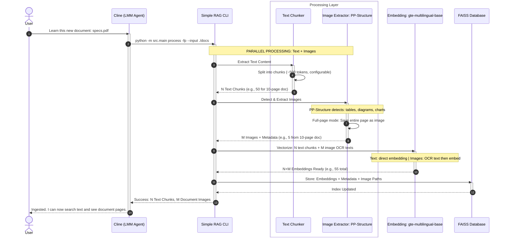
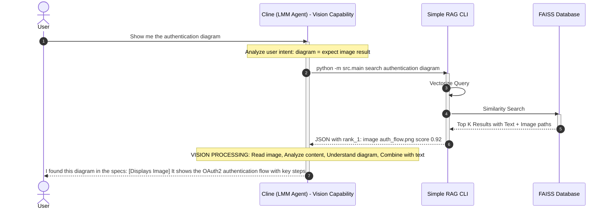
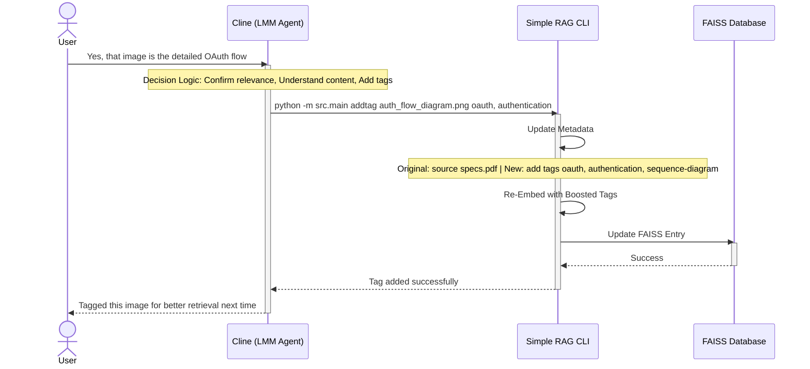
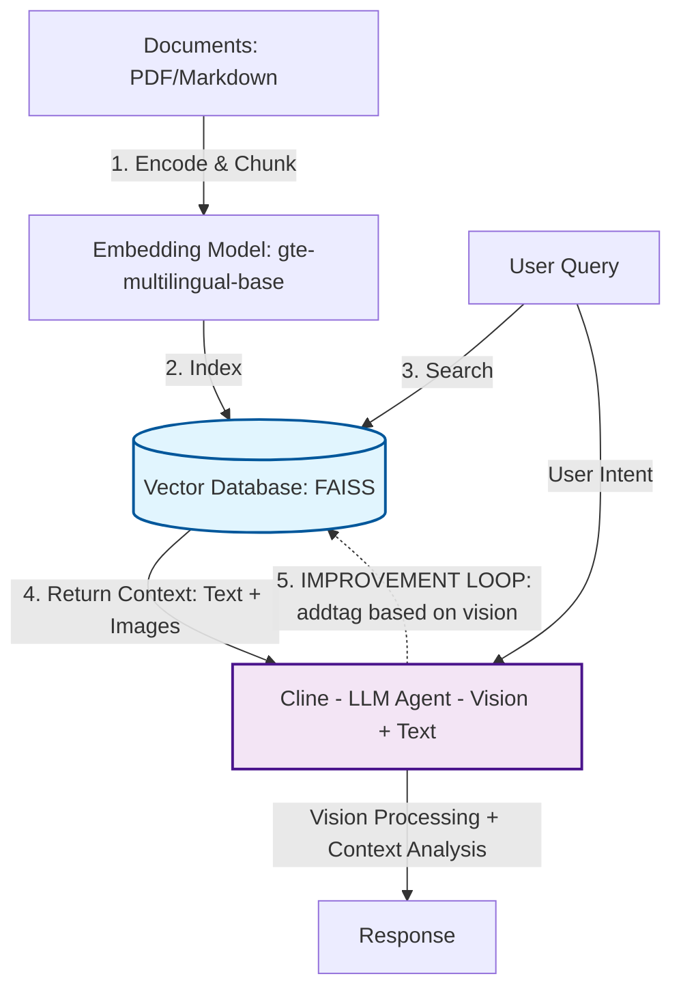

# Tích Hợp Cline + Simple RAG System

> **Mục đích**: Tài liệu này mô tả cách tích hợp giữa Cline (LLM Agent) và Simple RAG CLI, đặc biệt nhấn mạnh khả năng **Vision** của Cline trong việc xử lý kết quả tìm kiếm có chứa hình ảnh.

## 1. Tổng quan Kiến trúc

Simple RAG không chỉ là một công cụ tìm kiếm văn bản thông thường - nó được thiết kế để tích hợp sâu với các LLM Agent có khả năng multimodal (xử lý cả văn bản và hình ảnh). Cline, với khả năng vision, có thể:

- **Đọc kết quả văn bản** từ Simple RAG
- **"Nhìn" và phân tích hình ảnh** được trả về từ search results
- **Hiểu context** từ cả hai nguồn thông tin để đưa ra câu trả lời chính xác
- **Tự động gắn tag** cho hình ảnh sau khi "hiểu" nội dung, giúp cải thiện độ chính xác tìm kiếm trong tương lai

## 2. Quy Trình Tương Tác Chi Tiết (3 Phases)

### Phase 1: INGESTION - Cập nhật kiến thức

**Mục đích**: Nạp tài liệu mới vào hệ thống để Cline có thể tra cứu sau này.



**Chi tiết kỹ thuật xử lý**:

#### 1. Text Processing (Chunking)
- **Input**: PDF text content, Markdown files
- **Tool**: LangChain RecursiveCharacterTextSplitter
- **Logic**: 
  - Split by paragraphs, sentences
  - Chunk size: **~500 tokens (configurable)** - phụ thuộc use case
  - Overlap: **50 tokens (default)** - để giữ context liên tục
- **Output**: **N text chunks** (số lượng phụ thuộc vào document size) với metadata (source, page number)

> **Note**: Với document 10 trang thông thường → ~30-50 chunks. Document 100 trang → ~300-500 chunks.

#### 2. Image Processing (Extraction & Detection)
- **Input**: PDF pages
- **Tool**: PP-Structure (PaddleOCR)
- **Detection Logic**:
  ```python
  # Detect image regions using PP-Structure
  results = structure_engine.detect(page_image)
  # Filter: tables, figures, diagrams
  for region in results:
      if region.type in ['table', 'figure']:
          extract_and_save(region)
  ```
- **Full-Page Mode (`-fp`)**:
  - Lưu toàn bộ trang PDF dưới dạng ảnh
  - Tránh mất context khi cắt nhỏ
  - Phù hợp cho: flowcharts, architecture diagrams
- **Output**: Image files + OCR text + metadata

#### 3. Embedding Strategy
- **Text chunks**: Direct embedding với `gte-multilingual-base`
- **Images**: 
  1. OCR để extract text trong ảnh
  2. Embed OCR text (không embed pixel data)
  3. Store image path trong metadata
- **Kết quả**: Cả text và image đều có embedding vector trong FAISS

**Đặc điểm kỹ thuật**:

- **Embedding Model**: `gte-multilingual-base` (384 dimensions)
- **Vector Database**: FAISS Index (IndexFlatIP - Inner Product)
- **Image Extraction**: PP-Structure với full-page mode (`-fp`)

### Phase 2: RETRIEVAL - Tìm kiếm & Vision Processing

**Đây là phase quan trọng nhất** vì thể hiện khả năng multimodal của Cline.



**Chi tiết về Vision Processing**:

1. **Input từ Simple RAG**: Cline nhận được không chỉ metadata mà cả đường dẫn đến file ảnh thực tế
2. **Vision Analysis**: Cline sử dụng model multimodal để "xem" và phân tích nội dung hình ảnh
3. **Context Integration**: Kết hợp thông tin từ ảnh + text để tạo câu trả lời mạch lạc
4. **User Experience**: User thấy được cả ảnh gốc + phân tích chi tiết từ Cline

**Ví dụ thực tế**:

```json
// Simple RAG Search Output
{
  "results": [
    {
      "id": "doc_auth_page_05",
      "type": "image",
      "path": "/knowledge/docs/images/auth_flow_diagram.png",
      "metadata": {
        "source": "specs.pdf",
        "page": 5,
        "extraction_method": "fullpage"
      },
      "score": 0.92
    },
    {
      "id": "chunk_auth_text_001",
      "type": "text",
      "content": "The authentication system uses OAuth2 protocol for secure token-based access...",
      "score": 0.85
    }
  ]
}
```

```python
# Cline's Internal Processing (Pseudo-code)
def process_search_results(results):
    text_contexts = []
    image_contexts = []
    
    for result in results:
        if result['type'] == 'text':
            text_contexts.append(result['content'])
        elif result['type'] == 'image':
            # 🧠 VISION CAPABILITY
            image_path = result['path']
            image_analysis = vision_model.analyze(image_path)
            """
            image_analysis = {
                'detected_elements': ['flowchart', 'arrows', 'boxes'],
                'text_in_image': ['Login', 'OAuth Provider', 'Token'],
                'diagram_type': 'sequence_diagram',
                'main_flow': 'user_authentication_process'
            }
            """
            image_contexts.append(image_analysis)
    
    # Combine all contexts for response generation
    combined_context = {
        'text': text_contexts,
        'visual': image_contexts
    }
    
    return generate_answer(user_query, combined_context)
```

### Phase 3: FEEDBACK - Vision-to-Tagging

Sau khi Cline "hiểu" được nội dung hình ảnh, nó có thể **chủ động gắn tag** để cải thiện database.



**Lợi ích của Feedback Loop**:
- **Self-Improving Database**: Càng sử dụng, database càng chính xác
- **Semantic Enrichment**: Tags được gắn dựa trên "hiểu biết" thực sự của LLM, không chỉ keyword matching
- **Better Future Searches**: Lần tìm sau với từ khóa tương tự sẽ có độ chính xác cao hơn

## 3. Kiến Trúc Kết Nối Module

Sơ đồ high-level cho thấy mối quan hệ giữa các thành phần:



**Điểm nổi bật**:
- **Flow 4 (Dotted Line)**: Đây là vòng lặp cải tiến, giúp hệ thống RAG "thông minh hơn" theo thời gian
- **Vision Icon (🧠)**: Nhấn mạnh khả năng multimodal của Cline

## 4. Vai Trò Của Các Thành Phần

### 4.1. User (Developer/Lead)
- Đưa ra yêu cầu bằng ngôn ngữ tự nhiên
- Xác nhận/hướng dẫn Cline về độ phù hợp của kết quả

### 4.2. Cline (LLM Agent)
- **Bộ não trung tâm**: Hiểu ý định người dùng (Intent Recognition)
- **Multimodal Processing**: Xử lý cả văn bản và hình ảnh
- **Decision Making**: Quyết định gọi CLI nào (`process`, `search`, `addtag`)
- **Synthesis**: Tổng hợp thông tin từ nhiều nguồn (text + image) để trả lời mượt mà
- **Self-Learning**: Tự gắn tag dựa trên "hiểu biết" của mình

### 4.3. Simple RAG CLI
- **Công cụ thực thi kỹ thuật**: Xử lý dữ liệu nặng (PDF parsing, OCR)
- **Vector Operations**: Tính toán embedding và similarity search
- **Data Provider**: Cung cấp dữ liệu thô (text + image paths) cho Cline

### 4.4. Vector Database (FAISS)
- **Kho lưu trữ kiến thức dài hạn** của dự án
- **Dynamic Update**: Liên tục được cải thiện qua feedback loop

## 5. So Sánh: RAG Truyền Thống vs. Vision-Enhanced RAG

| Đặc điểm | RAG Truyền thống | **Vision-Enhanced RAG (Cline + SimpleRAG)** |
|----------|------------------|---------------------------------------------|
| **Input** | Chỉ văn bản | Văn bản + Hình ảnh (multimodal) |
| **Search Output** | Text chunks | Text chunks + Image paths |
| **LLM Processing** | Chỉ đọc text | 🧠 Đọc text + "Xem" và phân tích hình ảnh |
| **User Experience** | Text-only answer | Rich answer với ảnh minh họa + phân tích chi tiết |
| **Feedback Loop** | Không có hoặc manual | **Tự động** - LLM tự gắn tag dựa trên vision understanding |
| **Database Quality** | Static | **Dynamic** - tự cải thiện theo thời gian |

## 6. Kết Luận

Tích hợp Cline với Simple RAG tạo ra một hệ thống RAG **thế hệ mới**:

✅ **Multimodal**: Xử lý cả văn bản và hình ảnh  
✅ **Intelligent**: Cline "hiểu" thực sự nội dung, không chỉ keyword matching  
✅ **Self-Improving**: Database tự động được làm giàu qua feedback loop  
✅ **User-Friendly**: Kết quả trực quan, dễ hiểu với cả ảnh và text  

**Use Cases lý tưởng**:
- Technical documentation với nhiều diagrams/flowcharts
- Architecture design documents
- Product catalogs với hình ảnh sản phẩm
- Research papers với charts/graphs
