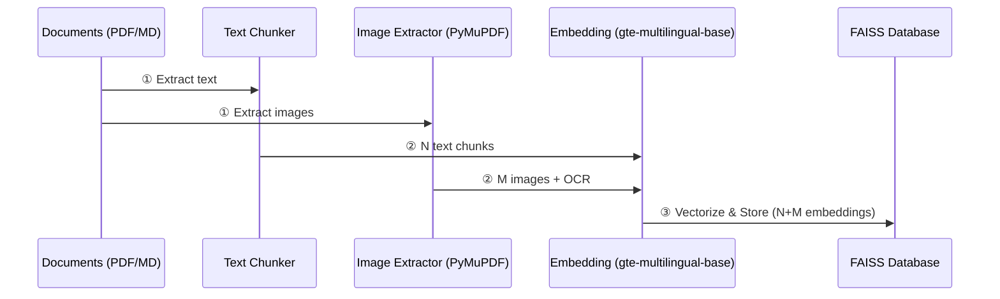
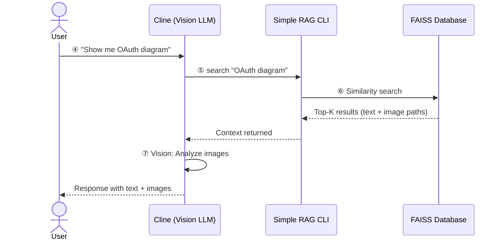
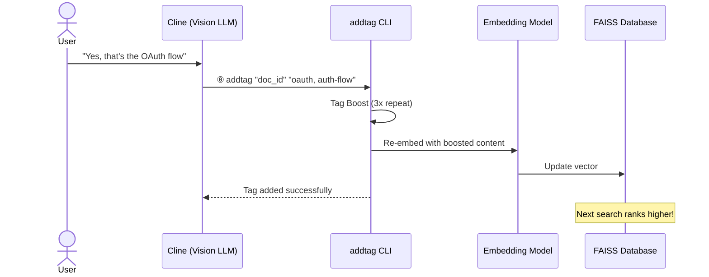
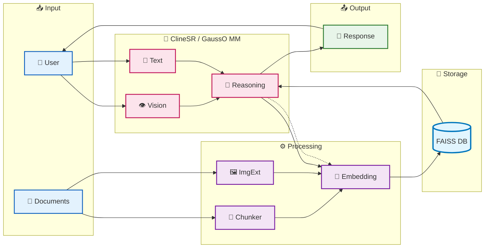

# Cline + Simple RAG Integration Report (Summary)

> 📖 **Chi tiết đầy đủ**: [10-debuit-clineSR.md](./10-debuit-clineSR.md)

---

## 1. Phase 1: INGESTION (Nạp dữ liệu)



---

## 2. Phase 2: RETRIEVAL (Tìm kiếm)



---

## 3. Phase 3: FEEDBACK (Cải thiện)



---

## 4. Kiến Trúc Kết Nối Module



**Flow Summary:**

| Flow | Path | Steps |
|------|------|-------|
| **Ingestion** | `Docs → Chunker/ImgExt → Embed → FAISS` | ①②③ |
| **Query** | `User → Vision/Text → Reasoning → Embed → FAISS → Reasoning → Response` | ④⑤⑥⑦ |
| **Feedback** | `Reasoning ⇢ Embed → FAISS` (dotted) | ⑧ |
| **Return** | `Response → User` | - |


---

### 🔵 INGESTION PIPELINE (Steps ①②③)

```
📄 Documents (PDF/Markdown)
         ↓ ①
   ┌─────┴──────┐
   ↓            ↓
🔪 Chunker   🖼️ ImgExt
(~500 tokens)  (PyMuPDF)
   ↓            ↓
   N chunks     M images + OCR
   └─────┬──────┘
         ↓ ②
   🧠 Embedding Model
   (gte-multilingual-base)
         ↓ ③
   💾 FAISS Database
   (N+M vectors indexed)
```

| Step | Component | Input | Output |
|------|-----------|-------|--------|
| **①** | Chunker & ImgExt | PDF/MD files | N text chunks (~500 tokens each) + M images |
| **②** | Embedding Model | Text + OCR content | 384-dim vectors for each chunk/image |
| **③** | FAISS Index | N+M embeddings | Indexed vector database |

---

### 🟢 QUERY PIPELINE (Steps ④⑤⑥⑦)

```
👤 User
   ↓ ④ Multimodal Query
📧 Query (Text + Image)
   ├──→ 📝 Text Processing
   └──→ 👁️ Vision Processing
         ↓
   🧠 Reasoning (ClineSR/GaussO MM)
         ↓ ⑤
   🧠 Embed → Query Vector
         ↓
   💾 FAISS Similarity Search
         ↓ ⑥
   📑 Top-K Results (text + image paths)
         ↓
   🧠 Reasoning + Vision Analysis
         ↓ ⑦
   💬 Response (Text + Images)
         ↓
   👤 User receives answer
```

| Step | Component | Input | Output |
|------|-----------|-------|--------|
| **④** | User → Agent | Text query + optional image | Multimodal input to Agent |
| **⑤** | Agent → Embed → FAISS | Query content | Query vector → Similarity search |
| **⑥** | FAISS → Agent | Query vector | Top-K relevant chunks + image paths |
| **⑦** | Agent (Vision + Reasoning) | Context + original query | Generated response with images |

---

### � FEEDBACK LOOP (Step ⑧)

```
🧠 Agent (After generating response)
   ↓
   Decision: Tag this content for better search
   ↓ ⑧
🏷️ addtag CLI
   ├── 1. Retrieve current content
   ├── 2. Boost: content + "Tags: oauth, oauth, oauth, ..."
   ├── 3. Re-embed with gte-multilingual-base
   ├── 4. DELETE old FAISS entry
   └── 5. ADD new entry with boosted vector
   ↓
💾 FAISS Database UPDATED
   ↓
✨ Next search ranks this document higher!
```

| Step | Action | Description |
|------|--------|-------------|
| **⑧.1** | Retrieve | Lấy content và metadata hiện tại từ FAISS |
| **⑧.2** | Tag Boost | Append tag lặp lại 3x để tăng semantic weight |
| **⑧.3** | Re-embed | Tạo embedding mới với boosted content |
| **⑧.4** | Delete | Xóa entry cũ khỏi index |
| **⑧.5** | Add | Thêm entry mới với vector cập nhật |

---

## 5. Agent Layer Details (ClineSR / GaussO MM)

| Component | Description |
|-----------|-------------|
| **👁️ Vision Processing** | Phân tích hình ảnh đầu vào từ user (screenshot, diagram, photo) |
| **📝 Text Processing** | Xử lý câu hỏi dạng text, extract intent và keywords |
| **🧠 Reasoning & Generation** | Kết hợp: query + retrieved context + vision analysis → generate response |

**Capabilities:**

- Multimodal input: Nhận cả text và image từ user
- Vision analysis: "Xem" và hiểu nội dung hình ảnh
- Context fusion: Kết hợp retrieved text chunks với image OCR
- Self-improvement: Tự động tag để cải thiện search quality

---

## 6. Key Highlights

| Feature | Description |
|---------|-------------|
| **Vision-Enhanced RAG** | Agent có khả năng "xem" và phân tích hình ảnh |
| **Multimodal Query** | User có thể query bằng text + image |
| **Hybrid Search** | Text chunks + Full-page images trong cùng database |
| **Self-Improving** | Feedback loop (⑧) giúp database chính xác hơn theo thời gian |
| **Tag Boosting** | Lặp lại tag 3x để tăng semantic weight khi re-embed |

---

> 📖 **Chi tiết đầy đủ**: [10-debuit-clineSR.md](./10-debuit-clineSR.md)

