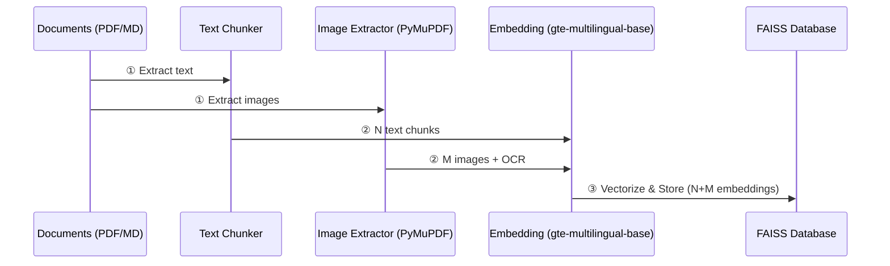
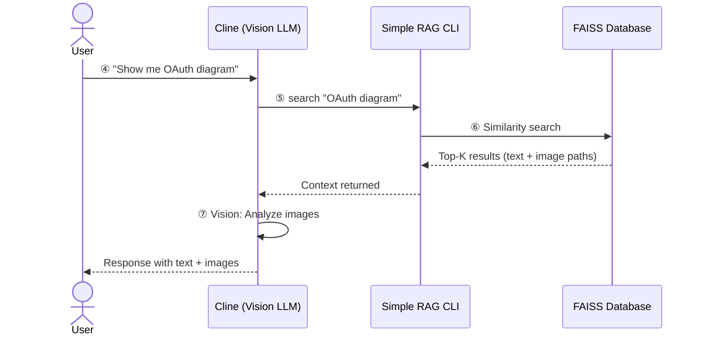
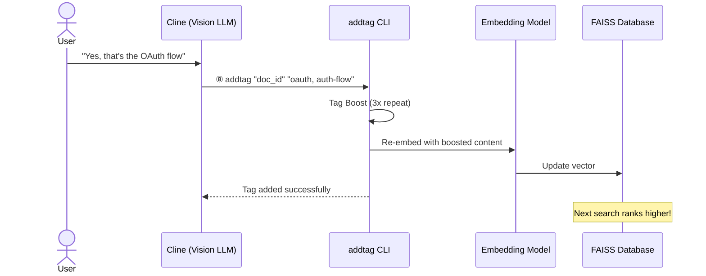
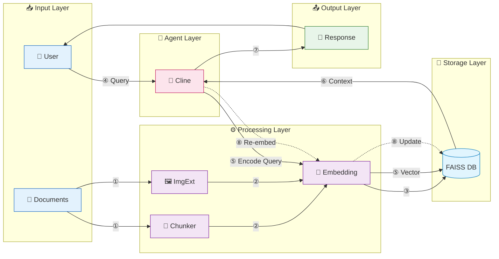

# Cline + Simple RAG Integration Report (Summary)

> 📖 **Chi tiết đầy đủ**: [10-debuit-clineSR.md](./10-debuit-clineSR.md)

---

## 1. Phase 1: INGESTION (Nạp dữ liệu)

---

## 2. Phase 2: RETRIEVAL (Tìm kiếm)

---

## 3. Phase 3: FEEDBACK (Cải thiện)

---

## 4. Kiến Trúc Kết Nối Module

**Flow Legend:**
- **Solid arrows (→)**: Main data flow
- **Dotted arrow (⇢)**: Feedback loop
- **① → ③**: Ingestion pipeline (Docs → Embed → FAISS)
- **④ → ⑦**: Query pipeline (User → Cline → **Embed** → FAISS → Cline → Response)
- **⑧**: Feedback loop (Cline → **Embed** → FAISS update)

---

## 5. Tổng quan 8 bước

| Step | Component | Action |
|------|-----------|--------|
| **①** | Chunker & ImgExt | Extract content từ documents |
| **②** | Embedding Model | Vectorize text + images (OCR) |
| **③** | FAISS | Index vectors |
| **④** | User | Gửi câu hỏi |
| **⑤** | Search | Similarity search trong FAISS |
| **⑥** | Cline | Nhận context + vision analysis |
| **⑦** | Cline | Generate response |
| **⑧** | Feedback | Tag + Re-embed để cải thiện |

---

## Key Highlights

- **Vision-Enhanced RAG**: Cline có khả năng "xem" và phân tích hình ảnh
- **Hybrid Search**: Text chunks + Full-page images trong cùng database
- **Self-Improving**: Feedback loop (⑧) giúp database chính xác hơn theo thời gian
- **Tag Boosting**: Lặp lại tag 3x để tăng semantic weight khi re-embed
